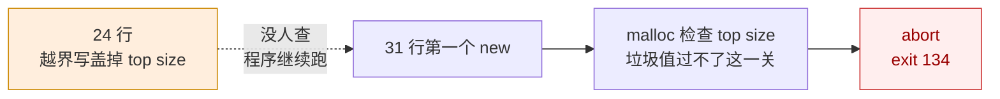

# Arrays: I Said Only Five! — Heap Buffer Overflow

In the previous case, we followed the trail of dangling pointers: memory has been released, but the pointer still holds on in your hand, reading and writing, and the buried bomb may even remain silent. This case is its close relative, with the root cause being the same: a few unnecessary writes, but the direction is reversed — in the previous case, the writes were inside, into memory that no longer belongs to you, while in this case, the writes are outside, crossing the boundary of your own array. Writing 1000 values into the array allocated with `new int[5]` is exactly what this case does.

I have seen several instances of such crash reports, and every time I see one, I want to plead for the person in the stack: the crash occurs in `operator new`, and the person reviewing the code stares at that line for a long time, it's perfectly honest in asking for 64 bytes, and there's no fault at all. The real culprit is actually dozens of lines away, hidden in the boundary of a loop, and the writer himself hasn't even noticed. So this case is also the most standard performance of our column's trademark phrase: "The error is here, the crash is there." The case of null pointers is more convenient, the line where you made the mistake is the one that takes the process away. The case of dangling pointers is more cunning, it may not even crash, and it may not even leave a body for you. The error in this case was committed at line 24 of crash.cpp, and the person died at line 31, with 7 lines of code and two `printf`s in between.

## Let's Create It

We can create the code for this case in just three lines, which is a bit too short:

```cpp
int* arr = new int[5];        // 5 个 int,20 字节
for (int i = 0; i < 1000; i++)
    arr[i] = 0xDEADBEEF;     // 从 arr[5] 开始,全是越界写
```

`new int[5]` gives you 5 ints, 20 bytes, and not a single extra byte. The loop, however, insists on writing from 0 to 999, and the out-of-bounds writing starts from the sixth element. Every write is outside the boundary. The complete reproduction code is in the accompanying code `code/volumn_codes/crash-lab/03-heap-buffer-overflow/crash.cpp`. After allocation, we also initialize the five elements to 0, 10, 20, 30, and 40, and after the out-of-bounds writing, we follow with 100 times of `new`/`delete` and one `delete[]`. The machine is my own WSL2, with a GCC 16.2.1 and glibc 2.44 environment, compiled with `-g -O0`, and we didn't use any sanitizer. The output is as follows:

```text
Array allocated at 0x60a73d065020, size = 5 ints
Writing far out of bounds (corrupting heap metadata)...
Wrote 1000 values to a 5-element array
Allocating more memory (triggers heap corruption crash)...
malloc(): corrupted top size
```

Let's go through it line by line, and there are three points worth your attention:

- All 1000 values are written, and `Wrote 1000 values` is also printed. During the out-of-bounds writing, the program remains intact.
- The last line `malloc(): corrupted top size` is not our `printf`, it's glibc's `malloc` itself that shouts it out, and the process is gone after that.
- The `new alloc #0` that should have been printed at the beginning of the loop is nowhere to be seen, and the program dies inside the first `new int[16]`.

The exit code we received this time is 134, and Linux's convention is 128 plus the signal number, and the 6th signal is named SIGABRT. In the case of null pointers, the 139 (segmentation fault) is intercepted by hardware, while in our case, the 134 is handled by glibc itself: it checks the heap at the entry of `malloc`, finds that the management data doesn't match, and aborts itself on the spot.

> We can read glibc's active abort in two ways. The downside is that the crash site is separated from the crime scene by the 7 lines we mentioned earlier, and the person investigating is pointed to an innocent `new`. On the brighter side, its death is clean and decisive, which is more dignified than silently going wrong. If you prefer not to crash, the root solution is clear: make the out-of-bounds write into a `std::out_of_range` that can be caught.

## The Dead is `new`, the Culprit is at Line 24

Next, we'll ask GDB to catch the corpse, and a single `bt` will give us the numbers (irrelevant system frames have been omitted):

```text
Program received signal SIGABRT, Aborted.
#2  abort () from /usr/lib/libc.so.6
#7  operator new(unsigned long) () from /usr/lib/libstdc++.so.6
#8  main () at crash.cpp:31
```

The frame at the bottom of the stack says `main () at crash.cpp:31`. Guess what line 31 is? `int* tmp = new int[16];`. This is a straightforward allocation, asking for 64 bytes of memory, and nothing else. The real culprit is at line 24's `arr[i] = 0xDEADBEEF;`, with the 1000 writes all coming from this line.

If you don't look at the source code, this stack can lead you into a ditch: who would suspect a `new` that just came in asking for 64 bytes? However, on the other hand, this stack points to the death site but doesn't mention the crime scene at all. If you want to find line 24, the only thing you have in your hands is the source code, plus my experience: if the crash occurs inside the allocator, the culprit is likely hiding in an out-of-bounds write elsewhere.

## Peeling Back the Bytes to See the Boundary

To understand what glibc is checking, we need to go back to before the incident and lay out the memory around `arr`. We open GDB, set a breakpoint at line 23, the out-of-bounds write hasn't happened yet, we get the address with `p arr`, and then we look at the values before `arr-8` and after `arr+16`:

```text
arr = 0x55555556b020 (chunk size field at arr-8, usable = 24 bytes)
0x55555556b018:  0x0000000000000021
--- boundary: your 24 usable bytes end at 0x55555556b038 ---
0x55555556b030:  0x0000000000000028  0x0000000000020fd1
```

> The line I added in the middle as the boundary separator is my own annotation, the rest are GDB's original outputs. Also, you can see this `0x55555556b020`, which is the same as the dangling pointer in the GDB of the dangling pointer case. It's not a coincidence: GDB turns off address randomization by default, and the starting point of the heap is always the same every time. If you directly run `./crash`, you'll get the `0x60a73d065020` you saw at the beginning, and it's different every time.

We recognize the bytes one by one. The glibc heap is not a large block of memory you can freely use; it slices the heap into chunks, each with its own size field, recording how big the chunk is. When you get the `arr` pointer, the header has already been skipped, so `arr-8` is exactly on top of the size field of your own chunk.

The first line's `0x21` can be split into 32 + 1: 32 is the total size of this chunk, and the lowest bit 1 is a flag (PREV_INUSE), indicating that the previous chunk is still in use. You requested 20 bytes, and glibc aligned it to give you a 32-byte block, subtracting 8 bytes of overhead, you have 24 bytes available, which is 4 bytes more than requested, and the extra 4 bytes are the padding.

The second line starts from `arr+16` and dumps the values, with two 8-byte values that are both significant. The first 8 bytes — can you guess how they are formed? It's the value of arr[4], which is 40, or hexadecimal 0x28, and the padding is combined together. The second 8 bytes are even more interesting, located at `arr+24` — your 24 bytes end here, and the next chunk is special: it's the top chunk that glibc shouts out the `corrupted top size` message for, and the top chunk refers to it, the large contiguous block of memory in the heap that hasn't been allocated yet. The size field is written as 0x20fd1, subtracting the flag, the chunk size is 0x20fd0, which is 135120 bytes in scale. Every time you call `new`, the new memory is cut from it.

So the boundary is clear: arr[5] falls into your own padding, still within your 24 bytes. But arr[6] is different — we write one stroke down, covering the size field of the top chunk.


We move the breakpoint to line 29, after the 1000 writes are completed, and dump the same memory again, starting from `arr+8`, which is all `0xdeadbeefdeadbeef` — our own elements, padding, and the size field of the top chunk, all painted over with 0xDEADBEEF.

We add one more calculation, and you'll understand why Linux doesn't even give you a segmentation fault during the writing process: the 1000 ints we wrote total 4000 bytes, and the top chunk has 135120 bytes under its name, and the out-of-bounds writes all fall into the pages that are still mapped, with page permissions being writable, and the CPU allows every single one. The MMU that stopped you in the null pointer case has no role to play in this case, the out-of-bounds address is a legitimate mapped memory, so the hardware doesn't care. Whether or not to stop is not up to us, it depends on when glibc's check comes.



## One Extra Write Is Okay, Two Extra Writes Are Fatal

The boundary between the padding and the top size is clear, so we'll take a copy of crash.cpp and make two variants for further experiments, keeping the rest of the code the same. One variant writes only to arr[5], and the other writes only to arr[6], each running separately.

The variant that writes only to arr[5] completes all 100 times of `new`/`delete` and the final `delete[]`, and the program exits quietly, giving us exit code 0. That single write falls into the 4-byte padding, and no one notices it.

The variant that writes only to arr[6] is not so polite, you can see:

```text
arr[6] written
malloc(): corrupted top size
```

We get exit code 134, and the death is exactly the same as the original. arr[6] covers the low 4 bytes of the top size, changing the size from 0x20fd1 to a garbage value, and the next `new` is blocked by glibc's check.

| Variant | Result | Reason |
|--------|--------|--------|
| Only out-of-bounds write to arr[5] | 100 times of `new`/`delete` all pass, exit 0 | Falls into the 4-byte padding, no one is hurt |
| Only out-of-bounds write to arr[6] | Next `new` is fatal, exit 134 | Covers the size field of the top chunk, glibc aborts |

You can't help but exclaim: one side is a silent exit with code 0, and the other is a guaranteed death with code 134, the dividing line is drawn at where your 24 bytes end. The common saying is that the more out-of-bounds writes you make, the more dangerous it is, and the direction is correct, but the actual boundary is much sharper: what matters is not how many writes you make, but which one crosses `arr+24`.

The C++ standard has never promised the safety of arr[5], today's non-crash is all due to coincidence: the code on hand, this glibc, this alignment, any one missing would change everything. If you change the compiler, or change the size of the allocation, the padding disappears, and the same line of code immediately changes its face. Let's shift our perspective to the real world, heap overflow is a common guest of security vulnerabilities: CVE-2021-22555 is a ready example, the heap overflow in the Linux kernel Netfilter module, in the real system, can really elevate privileges, relying on the ability to destroy the adjacent heap blocks with out-of-bounds writes, and the program doesn't crash, which is what attackers love.

## The Same Error, a Different Death on Windows

We move the same crash.cpp to MSVC 19.51 / Windows x64 and run it, the output is as follows:

```text
Array allocated at 00000208860E8940, size = 5 ints
Writing far out of bounds (corrupting heap metadata)...
crash exit code: -1073741819 (0xC0000005 = STATUS_ACCESS_VIOLATION)
```

You can see the difference. On the Linux side, glibc survives the entire 1000 writes, even finishes the final `printf`, and dies at the first `new` after the event, leaving a last message. On the Windows side, it's not patient enough, and it dies before even printing `Wrote 1000 values`, dying during the writing process, not after the allocation, which is proven by the output. If we dig deeper into the cause of death, we don't have byte evidence from the Windows heap, so we won't guess.

The same error handed to two heap managers results in two different deaths. The death is changing with the platform, ultimately following the practices of each heap manager. The two outputs we have are ready comparisons. The only thing that remains unchanged is this: out-of-bounds writes are definitely undefined behavior, and the standard makes no promises about any outcome.

## ASAN: The First Out-of-Bounds Write Is Caught

It's time for our old friend AddressSanitizer to make an appearance. You can guess what happens — ASAN takes this case down with one sentence. We compile with `-fsanitize=address` and run it again, the output is as follows, with irrelevant frames omitted:

```text
==3944==ERROR: AddressSanitizer: heap-buffer-overflow on address 0x77aec5fe0054
WRITE of size 4 at 0x77aec5fe0054 thread T0
    #0 0x5850e07bd31f in main crash.cpp:24

0x77aec5fe0054 is located 0 bytes after 20-byte region [0x77aec5fe0040,0x77aec5fe0054)
allocated by thread T0 here:
    #1 0x5850e07bd22c in main crash.cpp:13
SUMMARY: AddressSanitizer: heap-buffer-overflow crash.cpp:24 in main
```

We read the report, and it's as clear as the case file: line 13 allocates 20 bytes, line 24 is the write, the first out-of-bounds write at i=5, the landing point is exactly at the right endpoint of the region — 0x77aec5fe0040 + 20 = 0x77aec5fe0054, which is spot on. ASAN stops the process at this point, leaving exit code 1, and the remaining 994 out-of-bounds writes never happen. GDB catches the corpse, but the cause of death has to be pieced together by us. ASAN catches the culprit on the spot, and it remembers for you which line allocated and which line did the writing. The red zone is buried, and we've already discussed the case of dangling pointers. As for when to use which tool in the family, the article [Volume 6 · ASAN Family](/vol6-performance/ch00-performance-mindset/03-asan-family-and-memory-safety) has a systematic explanation, and we won't repeat it here.

## Root Cause: Handing the Boundary Check to Containers

We can find the cause, but we also need to treat it. The root cause of this case is one sentence: using hand-written indices to manage heap arrays, with the boundary only existing in your mind. The root solution is also one sentence: hand the boundary check over to the container, turning the out-of-bounds write from a random 134 at some point into a catchable exception.

The accompanying `fixed.cpp` (in the same directory as crash.cpp) provides three fixes, with the main idea being: we no longer use `new[]` to create our own array and count the indices ourselves.

Fix one is to use `vector` and `at()`:

```cpp
std::vector<int> arr = {0, 10, 20, 30, 40};
arr.at(5) = 0xDEAD;   // 越界:抛 std::out_of_range,不是 UB
```

`at()` checks the boundary every time, and throws `std::out_of_range` if it goes out of bounds. If we really run `fixed.cpp`, the message we catch is:

```text
vector::_M_range_check: __n (which is 5) >= this->size() (which is 5)
```

The out-of-bounds index and the size are both reported to you in one sentence. We catch it and print it out, and the program continues on, exiting with code 0 — the crash becomes error handling, and what to do next is up to you, rather than waiting for the heap manager to kill you.

Fix two is to use `size()` to check the index before writing, and only proceed if `i < arr.size()` is true. Fix three is even more straightforward, writing a range for loop, `for (auto& v : arr)`, with no index existing at all, and out-of-bounds is no longer a possibility.

As for the choice between `at()` and `operator[]`, my stance is to default to `at()`. It's a little slower, just one integer comparison each time, but most programs won't even notice. In return, out-of-bounds writes will definitely throw an exception and expose the error on the spot. `operator[]` doesn't check, and out-of-bounds is directly undefined behavior, only worth using in performance-sensitive hot loops if you've already proven the index is in bounds. In cases where the boundary comes from user input, network, or files, don't hesitate — `at()` is not wrong at all.

The added benefit is real for us: `vector` manages memory itself, and the class of accidents where `new[]`/`delete[]` are mismatched also disappear.

The accompanying code is placed in `code/volumn_codes/crash-lab/03-heap-buffer-overflow/`, we've prepared a `crash.cpp` and a `fixed.cpp`, you can clone it down, run `cmake -B build && cmake --build build` and finish it, and then compare the outputs of both sides, and this case will be as if you've handled it yourself. As for the double free of the same memory, the case is already on the way, and the death is different from these three cases.

## References

- [cppreference: std::vector::at](https://en.cppreference.com/w/cpp/container/vector/at)
- [CVE-2021-22555: Turning \x00\x00 into 10000$](https://google.github.io/security-research/pocs/linux/cve-2021-22555/writeup.html)
