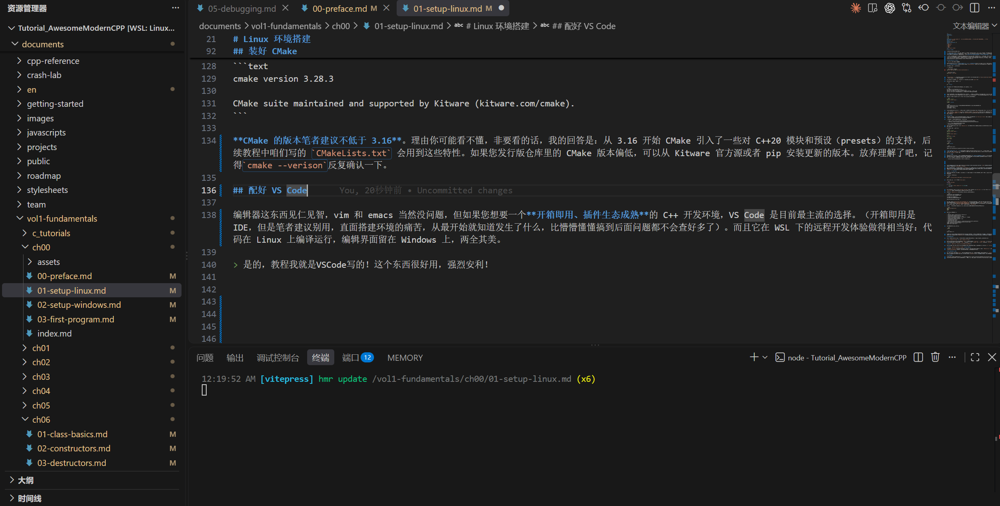

# Linux Environment Setup

Get moving! So says CharlieChen114514.

Alright, enough of the antics—before we put pen to paper on C++, we have to get the environment squared away first. What this article does is simple: build, from zero on Linux, a C++ development environment that can compile, can build, and is comfortable to write in. The whole thing takes roughly **fifteen minutes (or not; hard to say)**, but if this is your first time fiddling with Linux environment setup, set aside half an hour—hmm, or possibly a day, to be safe. This assumes you are already familiar with Linux; friends who aren't should head to the next article and do the Windows setup instead. Grinding through it anyway is not recommended. **But for Windows support, you will need to improvise a little, every single time~**

Why Linux? To put it bluntly, the entire C++ toolchain ecosystem grew up around Unix/Linux. GCC's first line of code dates back to 1987, and both Clang and CMake are Unix-first designs. When you compile and debug C++ code on Linux, the references you can dig up when things break, the answers on Stack Overflow, the CI configurations of open-source projects—almost all of it assumes you are running Linux. On top of that, later tutorials in this series will involve embedded cross-compilation and WSL development, so a Linux environment is a foundation you cannot get around. (One confession: Linux comes before Windows here also because I prefer developing on Linux—on my machine, Windows exists purely for gaming. Who on earth would charge headlong into Windows to write code? (kidding))

## Get the Compiler Installed! Taking Office on the C++ Journey

> "Bruh, what even is a compiler???"

A compiler is the tool that **translates C++ source code into binary files the machine can execute**. In the Linux world, the two mainstream C++ compilers are the **GCC (GNU Compiler Collection) suite** and **Clang (from the LLVM camp)**. Ubuntu/Debian's default `build-essential` package pulls in GCC together with the related build tools in one fell swoop—that's the least-effort option for us.

Depending on your distribution, run the matching command:

::: code-group

```bash [Ubuntu / Debian]
sudo apt update && sudo apt install build-essential -y
```

```bash [Arch Linux]
sudo pacman -S gcc make
```

:::

`build-essential` 是一个元包（meta package），它本身不包含任何软件，但会拉下来 `g++`、`gcc`、`make`、`libc6-dev` 等一系列编译必需的工具。咱们装完这一个包，基本的 C 和 C++ 编译环境就有了。

Arch 这边更省事，默认的 `gcc` 包已经包含 C++ 支持，咱们不用额外装 `gcc-c++`。

装好之后验证一下。打开终端，执行：

```bash
g++ --version
```

您看到的输出大概长这样（具体版本号会因发行版和更新状态而异）：

```text
g++ (Ubuntu 13.2.0-23ubuntu4) 13.2.0
Copyright (C) 2023 Free Software Foundation, Inc.
This is free software; see the source for copying conditions.  There is NO
warranty; not even for MERCHANTABILITY or FITNESS FOR A PARTICULAR PURPOSE.
```

只要能看到版本号输出，GCC 就装好了。这里笔者建议版本不低于 11——GCC 11 支持了 C++20 的大部分特性，后续教程中咱们会大量使用 C++17 和 C++20 的功能。如果您发行版自带的 GCC 比较老（比如 Ubuntu 20.04 默认是 GCC 9），可以考虑通过 PPA 或者编译源码来升级，这个暂时不展开。

您要是想顺便试试 Clang（后续教程中部分特性会用它做对比），可以这样装：

```bash
# Ubuntu / Debian
sudo apt install clang -y

# Verify
clang++ --version
```

```text
Ubuntu clang version 17.0.6 (++20231206065830+6009708b4367-1~exp1~20231206065905.65)
Target: x86_64-pc-linux-gnu
Thread model: posix
InstalledDir: /usr/bin
```

Clang 的报错信息比 GCC 更友好一些，调模板代码卡住的时候，笔者经常切到 Clang 看错误提示。不过日常开发用 GCC 完全够用，两个编译器保持装好就行，不冲突。

WSL 里装完还是 `command not found`，别慌，十有八九是漏跑了 `sudo apt update`，或者 WSL 的发行版压根没初始化好——在 WSL 终端里跑一遍 `sudo apt update && sudo apt upgrade -y`，再重装一次 `build-essential` 就行。另外 WSL 默认拉的 Ubuntu 镜像有时比较旧，拿不准就去 Microsoft Store 确认一下您的发行版版本。

## 装好 CMake

有了编译器，还需要一个构建工具来管理项目的编译流程。咱们可能会问——直接 `g++ hello.cpp -o hello` 不就行了？单个文件当然没问题，但真实项目的源文件往往有几十上百个，彼此之间还有依赖关系，手动敲编译命令根本不现实。

> 啥，你没见过CMake项目？这样，你打开Github，翻到
>
> - CFBox: <https://github.com/Awesome-Embedded-Learning-Studio/CFBox>
> - CFDesktop: <https://github.com/Awesome-Embedded-Learning-Studio/CFDesktop>
>
> 随便转转，我打赌你肯定不会手敲编译器命令的
> （当然没有再推广我的项目，我确信）

CMake 就是干这件事的：它读取一个叫 `CMakeLists.txt` 的配置文件，然后自动生成对应的构建脚本（比如 Makefile 或 Ninja 文件），把编译、链接这些脏活累活替咱们打理好。

安装 CMake 同样一行命令搞定：

```bash
# Ubuntu / Debian
sudo apt install cmake -y

# Fedora
sudo dnf install cmake -y

# Arch
sudo pacman -S cmake

# Yay users, rejoice
yay -S cmake
```

验证安装：

```bash
cmake --version
```

```text
cmake version 3.28.3

CMake suite maintained and supported by Kitware (kitware.com/cmake).
```

**CMake 的版本笔者建议不低于 3.16**。理由你可能看不懂，非要看的话，我的回答是：从 3.16 开始 CMake 引入了一些对 C++20 模块和预设（presets）的支持，后续教程中咱们写的 `CMakeLists.txt` 会用到这些特性。如果您发行版仓库里的 CMake 版本偏低，可以从 Kitware 官方源或者 pip 安装更新的版本。放弃理解了吧，记得`cmake --version`反复确认一下。

## 配好 VS Code

编辑器这东西见仁见智，vim 和 emacs 当然没问题，但如果您想要一个**开箱即用、插件生态成熟**的 C++ 开发环境，VS Code 是目前最主流的选择。（开箱即用是IDE，但是笔者建议别用，直面搭建环境的痛苦，从最开始就知道发生了什么，比懵懵懂懂搞到后面问题都不会查好多了）。而且它在 WSL 下的远程开发体验做得相当好：代码在 Linux 上编译运行，编辑界面留在 Windows 上，两全其美。

> 是的，教程我就是VSCode写的！这个东西很好用，强烈安利！



安装 VS Code 的方式很多，咱们走最省事的：去[官网](https://code.visualstudio.com/)下载 `.deb` 包（Ubuntu/Debian）或 `.rpm` 包（Fedora），然后双击安装。Arch 用户可以直接 `sudo pacman -S code`。

装好 VS Code 之后还差几个关键扩展。您按 `Ctrl+Shift+X` 打开扩展面板，头一个搜 C/C++（Microsoft 出品），语法高亮、智能提示、调试支持全靠它，是 VS Code 写 C++ 的基石；接着装同门的 CMake Tools，配置、构建、调试 CMake 项目都在编辑器里点按钮完成，不用切终端；再补一个 twxs 出品的 CMake，给 `CMakeLists.txt` 提供语法高亮和补全。三个装齐，这套环境就成型了。

## 跑通第一个 CMake 项目

到这里工具都齐了，咱们来实际操练一把：从零创建一个 CMake 管理的 C++ 项目，编译并运行。这一步如果顺利跑通，说明整个工具链配置没有问题，后续章节就可以安心写代码了。

找个地方建一个项目目录，Linux命令行刷起~

```bash
# Recursively create ~/projects and ~/projects/hello_cmake, then switch into it.
mkdir -p ~/projects/hello_cmake && cd ~/projects/hello_cmake
```

然后创建咱们的第一个 C++ 源文件 `hello.cpp`：

```cpp
// Create the file in VS Code, or with touch, or with echo "" > hello.cpp, whatever works~
#include <iostream>

int main()
{
    std::cout << "Hello, Modern C++!" << std::endl;
    return 0;
}
```

咱们先看这个最简单的 C++ 程序：`#include <iostream>` 引入标准输入输出库，`std::cout` 是 C++ 的标准输出流，`<<` 运算符把字符串送到输出流里。`std::endl` 除了换行之外还会刷新输出缓冲区，确保内容立刻显示。

接下来创建 `CMakeLists.txt`，这个文件告诉 CMake 咱们的项目怎么构建：

```cmake
cmake_minimum_required(VERSION 3.16)
project(hello_cmake LANGUAGES CXX)

set(CMAKE_CXX_STANDARD 20)
set(CMAKE_CXX_STANDARD_REQUIRED ON)

add_executable(hello hello.cpp)
```

欸欸欸别跑，我慢慢说。

- `cmake_minimum_required(VERSION 3.16)` 声明这个项目需要的最低 CMake 版本，如果您的 CMake 版本低于 3.16，配置阶段会直接报错而不是产生莫名其妙的构建失败。
- `project(hello_cmake LANGUAGES CXX)` 定义项目名称和支持的语言，`CXX` 是 CMake 里对 C++ 的代号。
- `set(CMAKE_CXX_STANDARD 20)` 把 C++ 标准设为 C++20，`CMAKE_CXX_STANDARD_REQUIRED ON` 确保如果编译器不支持 C++20 就直接报错，而不是悄悄降级。
- `add_executable(hello hello.cpp)` 声明咱们要构建一个叫 `hello` 的可执行文件，源文件是 `hello.cpp`。

现在咱们开始构建。CMake 推荐的做法是在单独的目录里构建，避免把生成的临时文件污染源代码目录：

```bash
mkdir build && cd build
cmake ..
make
```

您会看到类似这样的输出：

```text
-- The CXX compiler identification is GNU 13.2.0
-- Detecting CXX compiler ABI info
-- Detecting CXX compiler ABI info - done
-- Check for working CXX compiler: /usr/bin/c++ - skipped
-- Detecting CXX compile features
-- Detecting CXX compile features - done
-- Configuring done (0.3s)
-- Generating done (0.0s)
-- Build files have been written to: /home/charlie/projects/hello_cmake/build
[ 50%] Building CXX object CMakeFiles/hello.dir/hello.cpp.o
[100%] Linking CXX executable hello
[100%] Built target hello
```

构建成功。现在运行咱们的程序：

```bash
./hello
```

```text
Hello, Modern C++!
```

When you see that line of output, congratulations: the compiler, CMake, and the entire toolchain are all in place, and you can officially start writing C++. If you open this project directory with VS Code (`code ~/projects/hello_cmake`), the CMake Tools extension will recognize `CMakeLists.txt` automatically and configure the project; build and run buttons will appear in the status bar at the bottom, and from then on a click inside VS Code compiles and runs things—no more typing the commands every time.

## What to Do When You Hit Problems

Toolchain configuration is the step that varies the most from machine to machine, so stumbling into a pit here is perfectly normal. Here are a few of the most common errors and the corresponding lines of attack.

**`g++: command not found` or `cmake: command not found`**

This means the tool in question isn't installed, or is installed but isn't on your `PATH` environment variable. First check where they live with `which g++` and `which cmake`—if either comes back empty, reinstall the corresponding package. If a path comes back but the command still isn't found, your `PATH` configuration is the problem; check whether `~/.bashrc` or `~/.zshrc` has removed `/usr/bin` from `PATH`.

**CMake reports `CMake Error: Could not find CMAKE_CXX_COMPILER`**

This usually happens inside WSL or a Docker container—the system has CMake installed but no compiler. Go back to the compiler installation section, confirm that `g++ --version` prints normally, then rerun `cmake ..`.

**Linker errors during the build, like `undefined reference to symbol`**

The single-file `hello.cpp` won't run into this one. But once projects grow more complex later on, if you hit a linking error, it's almost always a forgotten library in `CMakeLists.txt`: the `target_link_libraries` command is missing the library in question. We'll cover this in detail in later chapters.

**Slow file system performance under WSL**

WSL accessing the Windows file system (paths under `/mnt/c/`) is far slower than accessing the native Linux file system. If your project lives under `/mnt/c/Users/.../projects/`, compilation will visibly chug. The fix is to keep the project in the Linux-side home directory (`~/projects/`) and edit it through VS Code's Remote - WSL.

**Anything else?**

For whatever remains, ask the community, ask an AI, or ask the gurus around you; you can also come straight to <https://github.com/Awesome-Embedded-Learning-Studio/Tutorial_AwesomeModernCPP> and open an Issue on this repository to ask me directly. I sometimes read Issues faster than I go through email. As for why this sits apart from the previous item—the reason has been given already: I'm honestly mediocre, truly no guru, but beginner questions I can help look at.
