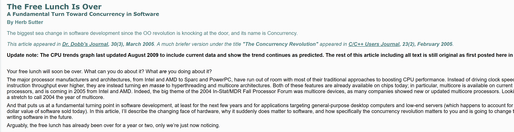

# Why You Can't Hide from Concurrency

Everyone, direct your attention to me! Look at me! I have an announcement to make!

There is no next sentence (laughs).

When you're in the middle of working and you see an old friend acting up again, chances are you won't stop what you're doing — at the very least you won't block right there watching me glitch out. More likely your ears track Charliechen114514 bouncing off the walls while your hands stay on your own task; it just adds one more processing stream in your head, right~

For everyone writing C++: if you are a beginner who has come all this way from the start, most of the programs you have written are **single-threaded**. Single-threaded? Some folks may be puzzled — what does that mean?

Now open the ordinary programs you wrote while following along. Setting aside agent assistance for a moment, you can picture the flow of execution starting from one `main`, running from top to bottom, with only one thing happening at any instant. When you talk about it with others, you also use **one single line** phrasing: first I call `A()`, then `B()`, and finally `clean_up()` on the way out — my program is done.

Straightforward, isn't it? Comfortable days, those. Because in that situation, from start to finish only one of us is doing the work: the value you read from a variable is exactly the one you just wrote, the order of function calls is the order of execution, and when something goes wrong you set a breakpoint, step through, and there is always some line where you can witness the scene with your own eyes.

Well, happy news: as of today, the day you step into this chapter, the good days are over. (despair)

## A Free Lunch, Handed to You

The single-threaded good days carried an unstated premise: hardware kept getting faster on your behalf. For twenty years, CPU clock speeds climbed almost every year. Without changing a line of code, you moved to a new machine and your old program got faster on its own — performance handed to you for free.

> So I remember a joke that circulated online: why bother improving your program? Just trust hardware to progress on its own!

Well, in 2026 that free lunch is gone. Twenty-two years ago, in 2004, the lunch ran out. That year Intel publicly cancelled its plan to push toward 4GHz and moved development over to dual-core, because clock speed was pinned down by heat dissipation and power consumption. Performance switched to a different track: instead of making one core faster, chip makers packed more and more cores onto a single chip. Today the phone in your pocket casually carries eight or nine cores, a dozen-plus cores on a desktop CPU is routine, and it has been that way for over twenty years.

The person who explained this turning point most incisively is Herb Sutter. In the March 2005 issue of Dr. Dobb's Journal he published [The Free Lunch Is Over](http://www.gotw.ca/publications/concurrency-ddj.htm), reminding everyone who writes software: the performance gains are still on the menu, but now you pay extra — in development effort, code complexity, and testing effort.

## What Makes It Hard: The Popular Accounts

Concurrency is unavoidable, so what exactly is hard about it? The community's story has gone through several rounds; let's pick the popular ones.

The most widespread account from the old guard: ordinary mortals cannot write multithreaded code correctly; only a handful of masters can keep a multithreaded program settled and stable.

> Even in the age of AI, this author will bet you: hand the job to a weaker AI, or even a stronger model — it still can't write concurrency well. The lock ends up too coarse, or too fine... It's fine if that means nothing to you yet; that is exactly what we will talk about later.

Multithreading itself may not be quite that eerie, but if you work in C++, odds are you will be rubbing elbows with concurrency every single day.

So which part is hard? All right, nobody will answer. The answer: what's hard to handle is the style of hunting for places to add locks all over the program. Think about it: every thread can reach the program's entire memory; you place lock after lock in every corner and hope they never clash — once the program gets big, nobody can truly hold it all together. The programs of that era that "claimed to run" hid countless weird bugs, each one ground smooth by human effort.

The idea that later became popular: keep sharing under watch. Some approaches have everyone use their own data and exchange things by passing messages — nobody touches anyone else's territory. Some approaches allow sharing but hard-code the discipline for lock usage, for example at most one lock held at any moment. Different routes, same idea: bring sharing under control, and multithreading stops being mystic — it becomes a craft that can be taught and learned. What Volume 5 teaches is how this family of ideas lands in C++.

Another popular view reminds you not to swing to the other extreme: sometimes sharing is actually the cheapest option. The most ready-made example is a database — one big block of data everyone reads and writes together, governed by a strict set of constraints, running steadily for decades. Truly ban sharing in one stroke, and many things that used to look simple suddenly require long detours.

Then there is the plain empiricist school — the one you meet most often in day-to-day engineering. A highly-voted answer that has hung on a venerable tech Q&A site for a decade gives far more down-to-earth advice: stay single-threaded where you can, touch as little shared data as possible if you must bring in threads, and don't spawn more threads than cores.

These are thoughts this author collected while surfing the internet — take them as something to hear, no more. Each side has its point. For you they share one practical use: don't trust any one-size-fits-all "this is how concurrency must be written." C++ has no intention of giving a single answer here either; it stocks an entire toolbox, each tool for a class of problems. The rest of Volume 5 is basically us walking you through that toolbox, one tool at a time.

## Hard, but Learnable

After all this, this author must confess: to this day, I still write concurrency code with a sense of awe.

Concurrency, unlike RAII or move semantics, has no crisp conceptual boundary where "learned it, used it in the right place" counts as mastery; it is a wholesale switch of mindset. Up to now you have written single-threaded code where everything is certain and everything is under control. Then one day the work stops fitting through one task loop, or a network service has to accept hundreds of connections at once, and you have no choice but to bring in multiple threads. From that moment on, even "whoa, what is this variable's value right now" has to be proven again — a question you never used to think about.

Hard as it is, the craft can be learned. Otherwise we wouldn't be sitting here talking about concurrency, would we?

In the next article we look at a scene you have probably seen: the lecture notes are still downloading while the course list has already scrolled down several rows. Of these two things the program is doing, which steps can go in any order, and which step genuinely has to wait? [The Lecture Notes Aren't Done Downloading — Why Can the List Already Scroll?](./01-work-and-order)

## Reference Resources

This article is a background piece — no code experiments. The historical narrative was checked against Herb Sutter's original The Free Lunch Is Over and public reporting on Intel's 2004 pivot to dual-core; the summaries of popular views reference classic Stack Overflow threads; chip specifications come from the official pages.

- [The Free Lunch Is Over — Herb Sutter](http://www.gotw.ca/publications/concurrency-ddj.htm) — Dr. Dobb's Journal, March 2005; the classic judgment at the multicore turning point.
- [Intel kills 4GHz Pentium — The Register](https://www.theregister.com/2004/10/14/intel_kills_4gh/) — contemporary coverage of Intel giving up the 4GHz push and pivoting to dual-core in October 2004.
- [Is multithreading always faster? — Stack Overflow](https://stackoverflow.com/q/27319446) — the single-threaded vs multi-threaded performance trade-off; the source of those plain rules of thumb.
- [RP2040 — Wikipedia](https://en.wikipedia.org/wiki/RP2040) — specifications of the one-dollar dual-core Cortex-M0+.
- [STM32H7 series — STMicroelectronics](https://www.st.com/en/microcontrollers-microprocessors/stm32h7-series.html) — official page for the Cortex-M7 + Cortex-M4 dual-core line.
