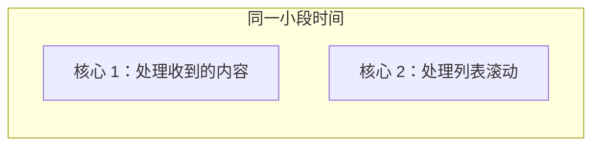

# How a Single CPU Core Takes Turns Doing Work

> If you are not interested in concurrency — or even parallelism — in the physical sense, feel free to skip this brief tour.

Last time we laid download and scrolling out into two diagrams, and the ending left a question: the computer doesn't have three heads and six arms, so how does it keep several things moving in turns? Today we'll actually borrow a CPU core, slice time into little slots, and see how several jobs get packed in.

## Drawing a Row of Time for One Core

The one doing the work is the CPU. The chip you see when you open the case (don't actually open it — if you can't put it back together, don't come looking for me (smirk)) holds anywhere from one to dozens of **cores**, and these little fellows are the ones executing instruction after instruction. Let's not get greedy — drawing one is enough. Each cell in the diagram is a short stretch of time, one cell holds one piece of work, and you read from left to right.

<ConcurrencyTimeline
  title="Single core · interleaved execution"
  axis-hint="Time flows right →"
  :ticks="['Slot 1', 'Slot 2', 'Slot 3']"
  :lanes="['One core']"
  :blocks="[
    { lane: 0, from: 0, to: 1, label: 'Send the download request', kind: 'download' },
    { lane: 0, from: 1, to: 2, label: 'Handle the list scrolling', kind: 'ui' },
    { lane: 0, from: 2, to: 3, label: 'Process the received content', kind: 'download' }
  ]"
  :kind-labels="{ download: 'Download-type work', ui: 'UI-type work' }"
>

</ConcurrencyTimeline>

In the first cell, once the download request has gone out, the data is still on the road, so the work in that cell counts as done. You nudge the scroll wheel down; the second cell happens to be free, so it is used to handle the scrolling. When the data arrives, the third cell processes the received content. Looking back, there was only one core from start to finish, yet both the download and the scrolling moved forward. This job in one cell, that job in the next — we call it **interleaved execution**. The concurrency from the previous article, landed on a single core, looks exactly like this.

If you have two cores in hand, we can draw another diagram. This time assume the content has already arrived and you happen to scroll the list once more: the two pieces of work — processing the content and processing the scroll — can both start, and there happen to be two cores to each take one.

<ConcurrencyTimeline
  title="Two cores · parallelism"
  axis-hint="The same small stretch of time"
  :ticks="['']"
  :lanes="['Core 1', 'Core 2']"
  :blocks="[
    { lane: 0, from: 0, to: 1, label: 'Process the received content', kind: 'download' },
    { lane: 1, from: 0, to: 1, label: 'Handle the list scrolling', kind: 'ui' }
  ]"
  :kind-labels="{ download: 'Download-type work', ui: 'UI-type work' }"
>

</ConcurrencyTimeline>

Two rows landing in the same stretch of time, each with its own work — this picture is called **parallelism**. Take the second core away and we fall back to the first diagram; the job still gets done: download and scrolling remain concurrent, except that instead of two things running at the same time, it goes back to doing one for a while, switching, and doing the other for a while. From now on, when you run into the two words concurrency and parallelism, don't memorize definitions — drawing two timelines is enough: if things can move forward by taking turns, that is concurrency. Only when two pieces of work truly squeeze into the same small stretch of time is it parallelism.

## What Exactly Is Taking Turns

The things written in the diagram — handle the scrolling, download the lecture notes — are two jobs the program must do; we call them **tasks**. But the diagram, drawn this far, has a hole: a task only says what to do, not who does it. Suppose we really write two flows of execution, one managing the interface and one managing the download, each a sequence of steps from beginning to end. Each such flow of execution is a **thread**. Pull one out and look at it alone, and it still reads like the previous article: follow the steps one by one downward.

The business of taking turns belongs to the operating system. If the download thread flops down to wait for data after sending the request, the OS won't let the core sit idly by and wait with it; it swaps the interface thread in to work. When the data arrives, it swaps the download thread back in, resuming from where it last stopped. Who gets the core at this moment and who steps aside — that arrangement is called **scheduling**. At the instant of the swap the system has one more thing to do: save the outgoing thread's execution state as it was, otherwise it will forget where it had got to when it comes back on.

Line the three words up and compare: task says what is to be done; thread says which flow of execution does it; core says which piece of hardware is running the instructions. One task can be carried from start to finish by one thread, or split among several threads. One thread can also work through two lecture-note downloads one after another. How many jobs you have on hand and how many threads you open — that is decided by us, the people writing the program; the machine just takes the threads you hand it and runs them in turns.

::: warning Started first — does it also finish first?
Once both threads are running, which one finishes first depends not on which started earlier, but on when it got hold of a core and whether it stopped to wait along the way. If the interface needs the file before it can display the content, you have to spell that wait out in the program: merely placing the download-start statement earlier only establishes when the download begins; it says nothing about where the interface waits for the result. The order of starting you can write out; the order of finishing you cannot — that belongs to the runtime's scheduler.
:::

## Reference Resources

<ReferenceCard title="参考文献">

- [About Processes and Threads, Microsoft Learn](https://learn.microsoft.com/en-us/windows/win32/procthread/about-processes-and-threads) — thread execution states and execution on multiple processors.
- [CPU Analysis, Microsoft Learn](https://learn.microsoft.com/en-us/windows/win32/test/wpt/cpu-analysis) — the relationship among CPUs, physical cores, and logical processors.
- [Multitasking, Microsoft Learn](https://learn.microsoft.com/en-us/windows/win32/procthread/multitasking) — how the operating system divides time among threads, and how it saves and restores thread execution state.

</ReferenceCard>
