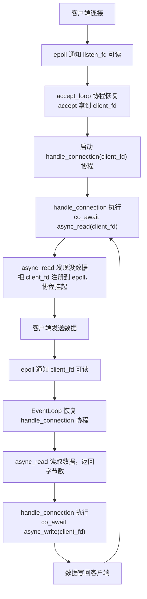

# Coroutine Echo Server

This piece is a practical exercise in the readings section, chained with [Asynchronous I/O and Event Loops](06-async-io-event-loop): a complete coroutine runtime does not enter the required line — Unit 7 of Volume 5 teaches only the coroutine machinery and minimal task organization ([Organizing Coroutines into Completable Tasks](../../chapter07-coroutines/04-task-type)) — and the real-network-service layer, whole, migrated into the readings section.

Before reading it, you need the coroutine frame, `promise_type`, and the awaiter protocol from Unit 7's main text, plus the epoll and event loop of Asynchronous I/O and Event Loops. With those in place, network system calls are not a prerequisite — the text explains them on the spot. Linux command-line operations (nc, the load-test script) are given where used.

The migration trail: mechanism explanations, code, test output, and load-test readings are preserved as they were; what I changed is limited to numbering, frontmatter, and the cross-references pointing at the main text, plus a banned-words-list cleanup. The material's claimed test environment and readings (the performance-peek section at the end) remain as-is; I did not re-measure this round.

With the coroutine language machinery plus the event-loop foundation all laid out, we finally arrive at the practical step. Every earlier step was preparation for this moment: using the coroutine framework we built ourselves, we write a network program that truly runs — a TCP echo server.

The echo server is network programming's "Hello World": whatever the client sends, the server sends back unchanged. It is simple enough to have almost no business logic, yet complete enough to cover every core link of network programming — create the listening socket, accept connections, read data, write data back, handle connection close and errors. When you can string these links together elegantly with coroutines, you have truly grasped the essence of the coroutine-based asynchronous I/O paradigm.

## Environment Note

This piece is a complete network-programming exercise, so the environment demands are more specific than in the previous ones. The operating system must be Linux (WSL2 works too, kernel 5.x+), because epoll is a Linux-specific API; macOS users can do similar things with kqueue, but the code needs changes. On the compiler side we need GCC 11+ or Clang 15+ — either, with `-std=c++20`, enables coroutine support (GCC 10 needs the `-fcoroutines` flag; GCC 11 and later do not). Build options `-std=c++20 -O2` suffice; add `-Wall -Wextra` to keep the warnings on. For tools, manual testing just needs `nc` (netcat) or `telnet`; performance testing needs `wrk` or `ab` (ApacheBench).

On Ubuntu/Debian the dependencies install simply; let us get them in:

```bash
sudo apt install netcat-openbsd wrk apache2-utils
```

## Overall Architecture: Draw the Blueprint Before Building

Before touching code, we need to be clear about which components make up the whole echo server and how they interact. Piling up code blindly only makes you doubt your life during debugging.

Our echo server consists of three core components; meet them one by one:

**EventLoop** is the heart of the whole system. It wraps epoll and takes charge of "notifying whoever's data is ready". The previous piece built a minimal version; this piece improves it — adding coroutine lifecycle management and support for dynamically registering and removing fds. The EventLoop runs one infinite loop in one thread: call `epoll_wait` to obtain ready fds, recover the corresponding coroutine handles from `epoll_event.data.ptr`, and `resume()` them.

**The asynchronous I/O awaiters** (`async_accept`, `async_read`, `async_write`) are the bridge between coroutines and the EventLoop; take them one by one: each awaiter wraps one concrete I/O operation, and when the operation cannot complete immediately (returning `EAGAIN`), the awaiter registers the current coroutine with epoll and suspends. When the data is ready, the EventLoop resumes the coroutine, which retries the I/O operation.

Next, meet **the handle_connection coroutine**: it maps one-to-one with each client connection, an independent coroutine. You will see it, in an infinite loop, do `co_await async_read` then `co_await async_write`, until the client disconnects. The "one coroutine per connection" pattern makes the code look almost identical to synchronous blocking programming, while underneath runs an efficient single-threaded event-driven model.

The data flow, drawn as a diagram, looks roughly like this:



The whole flow completes inside a single thread, yet multiple clients are handled concurrently all the same: each client owns its coroutine, and a coroutine waiting on I/O suspends and yields execution, blocking nobody.

## EventLoop: The Full Version of the Event Loop

The previous piece's EventLoop was a minimal prototype; this piece needs a more robust version. The core improvements: register the fd when a coroutine suspends, remove it after the coroutine resumes (because under LT mode leaving it registered fires repeatedly), and manage finished coroutines.

```cpp
#include <coroutine>
#include <cstdio>
#include <cstdlib>
#include <cstring>
#include <unistd.h>
#include <fcntl.h>
#include <csignal>
#include <sys/epoll.h>
#include <sys/socket.h>
#include <netinet/in.h>
#include <cerrno>
#include <unordered_set>
```

Look at the EventLoop class definition. Compared with the previous piece's version, we added a set of active coroutines for lifecycle management:

```cpp
/// 事件循环——封装 epoll，管理协程的挂起与恢复
class EventLoop {
public:
    EventLoop()
        : epoll_fd_(epoll_create1(EPOLL_CLOEXEC))
    {
        if (epoll_fd_ < 0) {
            perror("epoll_create1");
            std::abort();
        }
    }

    ~EventLoop() { close(epoll_fd_); }

    // 不允许拷贝和移动
    EventLoop(const EventLoop&) = delete;
    EventLoop& operator=(const EventLoop&) = delete;

    /// 注册 fd 到 epoll，关联一个协程 handle
    void add_event(int fd, uint32_t events, std::coroutine_handle<> handle)
    {
        struct epoll_event ev;
        ev.events = events;
        ev.data.ptr = handle.address(); // 核心技巧：把 handle 存进 epoll

        if (epoll_ctl(epoll_fd_, EPOLL_CTL_ADD, fd, &ev) < 0) {
            // fd 可能已经被注册过了，用 MOD 重试
            if (errno == EEXIST) {
                epoll_ctl(epoll_fd_, EPOLL_CTL_MOD, fd, &ev);
            } else {
                perror("epoll_ctl ADD");
            }
        }
    }

    /// 从 epoll 移除 fd
    void remove_event(int fd)
    {
        epoll_ctl(epoll_fd_, EPOLL_CTL_DEL, fd, nullptr);
    }

    /// 注册一个活跃协程（防止协程帧被提前销毁）
    void track_coroutine(std::coroutine_handle<> handle)
    {
        active_coroutines_.insert(handle);
    }

    /// 移除一个已结束的协程
    void untrack_coroutine(std::coroutine_handle<> handle)
    {
        active_coroutines_.erase(handle);
    }

    /// 运行事件循环
    void run();

    /// 停止事件循环
    void stop() { running_ = false; }

private:
    int epoll_fd_;
    bool running_ = true;
    std::unordered_set<std::coroutine_handle<>> active_coroutines_;
};
```

Here is a key design: the `active_coroutines_` set. It exists to solve the problem raised at the end of the previous piece: a coroutine's return object may be destroyed early, causing the coroutine frame to be freed. We use this set to hold every active coroutine handle, ensuring they are not destroyed while executing. When a coroutine ends, it removes itself from the set and calls `destroy()` to clean up the frame. In this piece's final implementation, though, we chose the simpler `DetachedTask` approach (the frame cleans up automatically when the coroutine ends), so `active_coroutines_` and its related methods go uncalled in the actual code. If you need finer-grained lifecycle management (waiting for coroutines externally, canceling them, and so on), the `track_coroutine`/`untrack_coroutine` machinery earns its keep.

> **`std::unordered_set<std::coroutine_handle<>>` requires a `std::hash<coroutine_handle>` specialization, which entered the standard library only with C++23.** GCC 14+ libstdc++ also provides this specialization as an extension under C++20 mode, but on some older compilers you may need `std::set<std::coroutine_handle<>>` instead (ordered by `operator<`, no hash needed) or a custom hasher.

Next, the event loop's `run()` method:

```cpp
void EventLoop::run()
{
    constexpr int kMaxEvents = 64;
    struct epoll_event events[kMaxEvents];

    while (running_) {
        int n = epoll_wait(epoll_fd_, events, kMaxEvents, 1000);
        if (n < 0) {
            if (errno == EINTR) {
                continue; // 被信号中断，重试
            }
            perror("epoll_wait");
            break;
        }

        for (int i = 0; i < n; ++i) {
            auto handle = std::coroutine_handle<>::from_address(
                events[i].data.ptr
            );
            if (handle && !handle.done()) {
                handle.resume();
            }
        }
    }
}
```

You will find `run()`'s logic dead plain: `epoll_wait` obtains ready events, the coroutine handle is recovered from `data.ptr`, and `resume()` is called. The 1-second timeout exists so the loop gets a chance to check the `running_` flag (for graceful exit). Handling `EINTR` is mandatory — press Ctrl+C to send SIGINT, and `epoll_wait` is interrupted, returning `-1` with `errno` set to `EINTR`; the loop must not exit then.

## The Task Types: Coroutine Wrappers with Automatic Cleanup

The previous piece defined a minimal `IoTask`, but it carries a serious problem: after the coroutine ends, the frame is not destroyed automatically; someone must call `destroy()` by hand. In production code that is a root of memory leaks. This time we design a more complete `Task` type that leverages the EventLoop's tracking machinery to ensure the frame is always cleaned up correctly.

```cpp
/// 协程任务类型——与 EventLoop 配合，自动管理生命周期
struct Task {
    struct promise_type {
        Task get_return_object()
        {
            return Task{
                std::coroutine_handle<promise_type>::from_promise(*this)
            };
        }

        // 惰性启动：协程创建时不执行，等外部 resume
        std::suspend_always initial_suspend() { return {}; }

        // 协程结束时挂起，由 EventLoop 负责清理
        std::suspend_always final_suspend() noexcept { return {}; }

        void return_void() {}
        void unhandled_exception() { std::terminate(); }
    };

    std::coroutine_handle<promise_type> handle;
};

/// Fire-and-forget 任务类型——协程结束后自动销毁
struct DetachedTask {
    struct promise_type {
        DetachedTask get_return_object()
        {
            return DetachedTask{
                std::coroutine_handle<promise_type>::from_promise(*this)
            };
        }

        // 创建时立即开始执行
        std::suspend_never initial_suspend() { return {}; }

        // 结束时自动销毁协程帧
        std::suspend_never final_suspend() noexcept { return {}; }

        void return_void() {}
        void unhandled_exception() { std::terminate(); }
    };

    std::coroutine_handle<promise_type> handle;
};
```

We defined two task types. `Task` is "lazy" — it does not execute on creation, needs an external `resume()`, and suspends at the end awaiting cleanup. It suits scenarios demanding precise control over execution timing, such as the accept loop.

`DetachedTask` is "fire-and-forget": it executes immediately on creation, and its frame destroys itself when the coroutine ends (because `final_suspend` returns `suspend_never`). It suits scenarios you start and never tend again, such as handling client connections. Each client connection creates one `DetachedTask`; when the connection is handled, the coroutine cleans up on its own — nothing for us to manage.

> **`DetachedTask`'s `final_suspend` returning `suspend_never` means the coroutine frame is destroyed the moment the coroutine ends. Convenient, but risky: if the coroutine holds references to destroyed objects (a dangling pointer, say), touching that reference before `final_suspend` is UB. Inside a DetachedTask you must therefore guarantee every captured resource stays valid — capture by value or by `shared_ptr`, never by raw pointer into stack variables.**

## Utility Functions: Creating the Non-Blocking Listening Socket

This part is standard Linux network programming with little to do with coroutines themselves, but rewriting it every time is tiresome. Let us wrap it up:

```cpp
/// 设置 fd 为非阻塞模式
/// 注意：本篇代码中 listen_fd 和 client_fd 都通过 SOCK_NONBLOCK 标志直接创建为非阻塞模式，
/// 所以这个函数实际上没有被调用。保留它是因为在实际项目中您经常需要把一个已有的 fd
/// （比如从 dup2 或 socketpair 得到的 fd）手动设置为非阻塞
void set_nonblocking(int fd)
{
    int flags = fcntl(fd, F_GETFL, 0);
    fcntl(fd, F_SETFL, flags | O_NONBLOCK);
}

/// 创建监听 socket，绑定到指定端口
int create_listen_socket(uint16_t port)
{
    int listen_fd = ::socket(AF_INET, SOCK_STREAM | SOCK_NONBLOCK | SOCK_CLOEXEC, 0);
    if (listen_fd < 0) {
        perror("socket");
        return -1;
    }

    // SO_REUSEADDR：允许端口在 TIME_WAIT 状态下被复用
    // 不加这个的话，重启服务器时可能遇到 "Address already in use"
    int opt = 1;
    setsockopt(listen_fd, SOL_SOCKET, SO_REUSEADDR, &opt, sizeof(opt));

    struct sockaddr_in addr {};
    addr.sin_family = AF_INET;
    addr.sin_addr.s_addr = INADDR_ANY;
    addr.sin_port = htons(port);

    if (::bind(listen_fd,
               reinterpret_cast<struct sockaddr*>(&addr),
               sizeof(addr)) < 0) {
        perror("bind");
        close(listen_fd);
        return -1;
    }

    if (::listen(listen_fd, SOMAXCONN) < 0) {
        perror("listen");
        close(listen_fd);
        return -1;
    }

    return listen_fd;
}
```

Two details deserve your eye. One is `SOCK_NONBLOCK | SOCK_CLOEXEC`: it puts the socket into non-blocking mode right at the `socket()` call while conveniently setting close-on-exec — more atomic than creating the socket and then calling `fcntl()`, avoiding the race window between `socket()` and `fcntl()` (though it is nearly impossible to trigger in this scenario).

The other is `SO_REUSEADDR`. After a TCP connection closes it enters TIME_WAIT (lasting about 2MSL, usually 60 seconds), during which the port cannot be reused. Restarting the server frequently while debugging without this option, you will run into "Address already in use" again and again. It is also recommended in production — Nginx does exactly this.

## async_accept: Coroutine-ized Connection Acceptance

Now into the core: `async_accept`. It is an awaiter wrapping the accept system call — no new connection, the coroutine suspends and the listen_fd is registered with epoll; a new connection arrives, the coroutine resumes and runs accept to obtain the client_fd.

```cpp
/// 全局事件循环实例
EventLoop g_event_loop;

/// 异步 accept 的 awaiter
struct AsyncAcceptAwaiter {
    int listen_fd_;

    explicit AsyncAcceptAwaiter(int listen_fd)
        : listen_fd_(listen_fd) {}

    bool await_ready() noexcept
    {
        // 理想做法是试一次非阻塞 accept——可能已经有等待的连接了，
        // accept 成功就不需要挂起，省去注册 epoll 的开销。
        // 这里简化处理，总是走挂起路径
        return false;
    }

    void await_suspend(std::coroutine_handle<> handle)
    {
        // 注册到 epoll，监听可读事件（新连接到达 = listen_fd 可读）
        g_event_loop.add_event(listen_fd_, EPOLLIN, handle);
    }

    int await_resume()
    {
        // 协程恢复后，从 epoll 移除 listen_fd
        // LT 模式下不移除的话，每次 epoll_wait 都会反复通知
        g_event_loop.remove_event(listen_fd_);

        struct sockaddr_in client_addr {};
        socklen_t addr_len = sizeof(client_addr);
        int client_fd = ::accept4(
            listen_fd_,
            reinterpret_cast<struct sockaddr*>(&client_addr),
            &addr_len,
            SOCK_NONBLOCK | SOCK_CLOEXEC
        );

        if (client_fd >= 0) {
            // accept4 带 SOCK_NONBLOCK，不需要再调 fcntl
            std::printf("[server] 新连接 fd=%d\n", client_fd);
        }
        return client_fd;
    }
};

/// 协程化的 accept——对外接口
AsyncAcceptAwaiter async_accept(int listen_fd)
{
    return AsyncAcceptAwaiter(listen_fd);
}
```

A few design choices here need explaining.

`await_ready()` bluntly returns `false` — always suspend. A more optimized version could try one non-blocking accept and return directly if a connection already sits in the queue, saving the epoll registration. For clarity, we use the simple version here.

Look at `await_suspend()`: it registers the listen_fd with epoll, listening for `EPOLLIN`. For a listening socket, `EPOLLIN` means "a new connection awaits accept".

`await_resume()` removes the listen_fd from epoll, then calls `accept4` for the new client_fd. Removal before accept, because under LT mode, if we left the listen_fd registered and called `epoll_wait`, it would keep telling us "listen_fd readable" — more connections may still be in the queue. We choose to accept one connection per round; taking several at once is entirely possible, but it would mean changing await_resume to return a connection list, a considerably more complex design.

The `SOCK_NONBLOCK | SOCK_CLOEXEC` we pass to `accept4` puts the client_fd directly into non-blocking mode — mandatory for the later async_read/async_write.

## async_read: Coroutine-ized Data Reading

`async_read` is the echo server's most central awaiter; take it slowly. It wraps the complete semantics of non-blocking read: data present, read directly; no data (`EAGAIN`), suspend and await the epoll notification.

```cpp
/// 异步 read 的 awaiter
struct AsyncReadAwaiter {
    int fd_;
    void* buffer_;
    std::size_t size_;
    ssize_t result_;
    bool suspended_ = false; // 是否经过了挂起路径

    AsyncReadAwaiter(int fd, void* buffer, std::size_t size)
        : fd_(fd), buffer_(buffer), size_(size), result_(0) {}

    bool await_ready() noexcept
    {
        // 快速路径：上来就试一次非阻塞 read
        result_ = ::recv(fd_, buffer_, size_, 0);
        if (result_ >= 0) {
            return true; // 读到了数据，不需要挂起
        }
        if (errno == EAGAIN || errno == EWOULDBLOCK) {
            return false; // 暂时没数据，需要等 epoll 通知
        }
        return true; // 其他错误（如连接重置），不挂起，让 await_resume 处理
    }

    void await_suspend(std::coroutine_handle<> handle)
    {
        // 没数据可读，注册到 epoll 等待 fd 可读
        suspended_ = true;
        g_event_loop.add_event(fd_, EPOLLIN, handle);
    }

    ssize_t await_resume()
    {
        if (suspended_) {
            // 挂起后恢复的路径：epoll 通知 fd 可读，尝试真正读取
            g_event_loop.remove_event(fd_);
            result_ = ::recv(fd_, buffer_, size_, 0);
        }
        // 快速路径（await_ready 返回 true）直接返回 result_
        return result_;
    }
};

/// 协程化的 read——对外接口
AsyncReadAwaiter async_read(int fd, void* buffer, std::size_t size)
{
    return AsyncReadAwaiter(fd, buffer, size);
}
```

Let us circle back and praise `await_ready()`'s fast path — an important optimization. In many scenarios the TCP receive buffer already holds data (especially when the client sends several messages in a row), and the whole ritual — suspend, register with epoll, await notification, resume — is unnecessary; just `recv`. This fast path saves at least one `epoll_ctl` system call and two coroutine context switches.

You may have noticed we use `recv` rather than `read`. The difference: `recv` takes a `flags` parameter — we pass 0 for now, but later `MSG_NOSIGNAL` will appear to dodge the SIGPIPE problem. `read` supports no flags.

`await_resume()` uses a `suspended_` flag to distinguish the two paths. An earlier version judged by `result_ < 0`, but there hides a subtle bug: if the fast path's `recv` returns a non-`EAGAIN` error (`ECONNRESET`, say), `result_` is negative and `await_resume` mistakes it for the suspension path, calling `remove_event` — yet the fd was never registered with epoll, and `remove_event`'s `epoll_ctl(DEL)` may modify `errno`, clobbering the real error code. The `suspended_` flag lets us precisely separate "fast path got an error and returned directly" from "resumed after suspension, then read".

## async_write: Coroutine-ized Data Writing

`async_write` is somewhat more complex than `async_read`, because a TCP write may deliver only part of the data. On a non-blocking socket, `send` may return fewer bytes than requested — not an error, just the send buffer temporarily unable to hold more. So we need to send in a loop until all data is out or an unrecoverable error appears.

```cpp
/// 异步 write 的 awaiter（需要处理部分写入）
struct AsyncWriteAwaiter {
    int fd_;
    const void* buffer_;
    std::size_t size_;
    std::size_t total_sent_; // 已发送的字节数
    bool has_error_ = false; // 是否遇到了不可恢复的错误

    AsyncWriteAwaiter(int fd, const void* buffer, std::size_t size)
        : fd_(fd), buffer_(buffer), size_(size), total_sent_(0) {}

    bool await_ready() noexcept
    {
        // 尝试发送所有数据
        return try_send_all();
    }

    void await_suspend(std::coroutine_handle<> handle)
    {
        // 发送缓冲区满了，注册 EPOLLOUT 等待 fd 可写
        g_event_loop.add_event(fd_, EPOLLOUT, handle);
    }

    ssize_t await_resume()
    {
        // 协程恢复后，epoll 通知 fd 可写
        // 此时发送缓冲区应该有空间了，继续尝试发送剩余数据
        // 注意：这里不做循环重试——如果又遇到 EAGAIN，说明 epoll 的可写通知
        // 不保证一次就能发完所有数据，但在 LT 模式下下次 epoll_wait 还会通知
        // 为了简化，这里如果还有未发完的数据就返回 -1 让调用者关闭连接
        // 生产级别的实现会在 await_resume 里重新注册 EPOLLOUT 再挂起
        g_event_loop.remove_event(fd_);
        if (!try_send_all() && total_sent_ < size_) {
            // 发了一部分但没发完，仍然有数据待发送
            // Echo Server 场景下数据量不大，这种情况极少发生
            // 但为了正确性，咱们标记为错误
            has_error_ = true;
        }
        if (has_error_) {
            return -1;
        }
        return static_cast<ssize_t>(total_sent_);
    }

private:
    /// 尝试发送所有数据，返回 true 表示全部发完或遇到错误
    bool try_send_all()
    {
        while (total_sent_ < size_) {
            const char* data = static_cast<const char*>(buffer_) + total_sent_;
            std::size_t remaining = size_ - total_sent_;

            // MSG_NOSIGNAL：对端关闭连接时不触发 SIGPIPE，而是返回 EPIPE
            ssize_t n = ::send(fd_, data, remaining, MSG_NOSIGNAL);

            if (n > 0) {
                total_sent_ += static_cast<std::size_t>(n);
                continue;
            }

            if (n < 0) {
                if (errno == EAGAIN || errno == EWOULDBLOCK) {
                    return false; // 发送缓冲区满了，需要挂起
                }
                // 其他错误（EPIPE、ECONNRESET 等）
                has_error_ = true;
                return true;
            }

            // n == 0 不应该在 send 上出现，但防御性处理
            has_error_ = true;
            return true;
        }
        return true; // 全部发完
    }
};

/// 协程化的 write——对外接口
AsyncWriteAwaiter async_write(int fd, const void* buffer, std::size_t size)
{
    return AsyncWriteAwaiter(fd, buffer, size);
}
```

`async_write`'s core logic lives in `try_send_all()`: loop over `send` until all data is out or the send buffer is full (`EAGAIN`). We added a `has_error_` flag to separate "all sent" from "unrecoverable error". Previously, with `total_sent_` as the return value, a partial write leaves `total_sent_` positive and the caller cannot tell "successfully sent this many bytes" from "an error occurred, though some went out midway". Now `await_resume` returns `-1` on error and the caller can close the connection correctly. The `MSG_NOSIGNAL` flag matters greatly: when the peer has already closed the connection and you write to the socket anyway, the kernel by default sends `SIGPIPE` to the process. `SIGPIPE`'s default action is to terminate the process — meaning your echo server dies outright because one client closed its connection. `MSG_NOSIGNAL` tells the kernel "no signal, just return an error", and `send` returns `-1` with `errno` set to `EPIPE`.

> **SIGPIPE is one of network programming's most classic problems.** Many beginners' servers crash inexplicably, and a long investigation reveals the client disconnected while the server kept writing, triggering SIGPIPE. Three fixes exist: the `MSG_NOSIGNAL` flag (per-call), globally ignoring with `signal(SIGPIPE, SIG_IGN)` (per-process, recommended), or on macOS/BSD the `SO_NOSIGPIPE` socket option (per-socket, unavailable on Linux). We choose `MSG_NOSIGNAL` here because it is the most precise — it affects only this one send call, not the whole process's signal behavior. But in some situations (with third-party libraries, say), `signal(SIGPIPE, SIG_IGN)` is more convenient.

## handle_connection: One Coroutine per Connection

With `async_read` and `async_write` in hand, the client-handling logic turns strikingly simple. The whole `handle_connection` is one infinite loop: read data, write it back, until the connection closes or errors.

```cpp
/// 处理单个客户端连接的协程
DetachedTask handle_connection(int client_fd)
{
    char buffer[4096];

    while (true) {
        // 异步读取客户端数据
        ssize_t n = co_await async_read(client_fd, buffer, sizeof(buffer));

        if (n <= 0) {
            // n == 0：对端关闭连接（优雅关闭）
            // n < 0：读取错误
            if (n == 0) {
                std::printf("[conn fd=%d] 客户端关闭连接\n", client_fd);
            } else {
                std::printf("[conn fd=%d] 读取错误: %s\n",
                            client_fd, std::strerror(errno));
            }
            close(client_fd);
            co_return;
        }

        // 异步写回——Echo！
        ssize_t written = co_await async_write(client_fd, buffer, n);
        if (written < 0) {
            std::printf("[conn fd=%d] 写入错误\n", client_fd);
            close(client_fd);
            co_return;
        }
    }
}
```

Look: this code looks almost identical to synchronous blocking network programming — a `while` loop with `read` then `write` inside. The only difference is `co_await` replacing direct calls. But the execution model underneath is entirely different: each `co_await` suspends the current coroutine when data is not ready, letting the event loop tend other coroutines. Macroscopically, hundreds or thousands of client-connection coroutines advance in turn within one thread. Microscopically, each coroutine consumes no CPU while waiting on I/O.

One detail deserves your eye: `char buffer[4096]` is a "local variable", but it does not live on the physical stack — `handle_connection` is a coroutine, and the compiler places all its locals into the heap-allocated coroutine frame. That means the buffer stays valid while the coroutine is suspended, unlike a normal function's stack variables that get overwritten after return. This is the fundamental reason coroutines can safely hold state across suspension points: your locals have been "promoted" to the heap. The price: every connection coroutine creation allocates a block of heap memory (at least 4KB, mostly the buffer's doing) — a non-negligible memory cost under high concurrency. Production-grade implementations we have seen usually go with a per-connection memory pool, or shrink the buffer and pair it with external buffer management.

Such is the beauty of coroutines — you write code in a synchronous frame of mind and get asynchronous execution efficiency.

The `DetachedTask` return type makes this coroutine "fire-and-forget". Once `accept_loop` starts it, you need not care when it ends or how it cleans up: at the end, `final_suspend` returns `suspend_never` and the frame destroys itself. `close(client_fd)` executes before the coroutine returns, ensuring the socket closes properly.

## accept_loop and main: Assembly and Startup

Now assemble all components. `accept_loop` is an infinite loop that keeps accepting new connections and starts an independent handle_connection coroutine for each:

```cpp
/// 接受新连接的协程
Task accept_loop(int listen_fd)
{
    std::printf("[server] 开始接受连接...\n");

    while (true) {
        int client_fd = co_await async_accept(listen_fd);

        if (client_fd < 0) {
            if (errno == EAGAIN || errno == EWOULDBLOCK) {
                continue; // 没有连接，理论上不会走到这里
            }
            std::printf("[server] accept 失败: %s\n",
                        std::strerror(errno));
            continue;
        }

        // 启动一个新的 DetachedTask 协程来处理这个连接
        // handle_connection 创建后立即开始执行（initial_suspend 返回 suspend_never）
        // 协程结束时会自动清理，不需要咱们管
        handle_connection(client_fd);
    }
}
```

One mistake-prone spot: if `handle_connection` returned a `Task` (lazy start), you would need to `resume()` it manually after creation. But we use `DetachedTask` (immediate start), so the moment `handle_connection(client_fd)` is called, the coroutine starts executing. It runs until the first `co_await async_read` — no data readable at that point, the coroutine suspends, control returns to accept_loop, and accept_loop keeps waiting for the next connection.

With `Task`, the code would read:

```cpp
// 如果用 Task 类型（惰性启动）
auto task = handle_connection(client_fd);
task.handle.resume(); // 手动启动
```

Both work the same, but `DetachedTask` better matches the "fire-and-forget" semantics — we need not care about the task's return value or lifetime.

Finally, the `main` function:

```cpp
int main()
{
    // 忽略 SIGPIPE——双重保险
    // 即使 async_write 用了 MSG_NOSIGNAL，全局忽略 SIGPIPE 也是好习惯
    std::signal(SIGPIPE, SIG_IGN);

    constexpr uint16_t kPort = 8080;

    int listen_fd = create_listen_socket(kPort);
    if (listen_fd < 0) {
        return 1;
    }

    std::printf("协程 Echo Server 启动，监听端口 %d\n", kPort);
    std::printf("测试方式: nc localhost %d\n", kPort);

    // 创建 accept 循环协程（惰性，还没开始执行）
    auto acceptor = accept_loop(listen_fd);

    // 手动启动 accept 协程
    // 它会执行到第一个 co_await async_accept，然后挂起
    // 把 listen_fd 注册到 epoll
    acceptor.handle.resume();

    // 进入事件循环——此后所有协程由 epoll 事件驱动
    g_event_loop.run();

    close(listen_fd);
    return 0;
}
```

Walk `main`'s flow: create the listening socket, start the accept coroutine, enter the event loop. The accept coroutine suspends at its first `co_await async_accept`, and the listen_fd is registered with epoll. From then on, whenever a new connection arrives, epoll reports the listen_fd readable, the event loop resumes the accept coroutine, the accept coroutine takes the new connection, starts a handle_connection coroutine, and returns to suspension to keep waiting.

`signal(SIGPIPE, SIG_IGN)` is the global insurance. Even though our `async_write` already uses `MSG_NOSIGNAL`, other places (some logging library or third-party code) may still call `write` directly rather than `send`, without `MSG_NOSIGNAL` protection. Globally ignoring SIGPIPE guards us against those surprises.

## Compiling and Running

Concatenate all the code above into one file (or compile separately, your preference) and build with:

```bash
g++ -std=c++20 -O2 -Wall -Wextra -o echo_server echo_server.cpp
```

Then start the server:

```bash
./echo_server
```

You should see:

```text
协程 Echo Server 启动，监听端口 8080
测试方式: nc localhost 8080
[server] 开始接受连接...
```

The server is waiting for connections; open another terminal and connect.

## A Troubleshooting Log

Several problems from implementing and debugging this echo server deserve recording. I fell plenty of times while writing this code; here they are sorted out so you do not fall again.

### Problem 1: SIGPIPE Makes Your Server Die Quietly

Mentioned earlier, but worth stressing once more. After the client closes the connection, if the server keeps writing to the socket, the kernel by default sends SIGPIPE. Its default action is to terminate the process — no core dump, no error message; the process simply vanishes. You might even think the server "exited normally" until nc fails to connect and something feels wrong.

The fix is already double-protected in our code: `MSG_NOSIGNAL` on `send`, plus `signal(SIGPIPE, SIG_IGN)` in `main`. Either alone suffices; both together are safer.

### Problem 2: Forgetting to Remove the fd Under LT Mode Causes an Event Storm

A genuinely interesting trap. Under LT (level-triggered) mode, as long as an fd has readable data, `epoll_wait` keeps notifying you. If your `await_resume` forgets to call `remove_event` to take the fd out of epoll, every `epoll_wait` returns that fd's event — even though you already handled it. The event loop then madly resumes the same coroutine; the CPU rockets to 100% while nothing useful gets done.

The `remove_event` calls in both `async_read`'s and `async_write`'s `await_resume` exist precisely to dodge this problem.

### Problem 3: Coroutine Frame Lifetime — Dangling Handles

Raised at the end of the previous piece; unfolded further here. When you create a coroutine (`handle_connection(client_fd)`, say), the coroutine's `promise_type` allocates a "coroutine frame" on the heap to hold the coroutine's locals and state. If the coroutine's return object (`DetachedTask` or `Task`) is destroyed before the coroutine finishes, and `final_suspend` returns `suspend_never` (auto-destroying the frame), no problem. But if `final_suspend` returns `suspend_always`, someone must `destroy()` the frame manually.

Our `DetachedTask` uses `suspend_never`, so the coroutine cleans up automatically at the end — no problem. But change `handle_connection` to return `Task` (`suspend_always`) and you must `destroy()` the frame somewhere, or it is a memory leak.

### Problem 4: The EPOLLOUT Trap — "Almost Always Writable"

A TCP socket is "writable" most of the time, because the send buffer is usually far from full (default size ranges from 16KB to several MB). That means if you register an fd with epoll for `EPOLLOUT`, `epoll_wait` returns almost immediately to say "this fd can be written". Fail to remove the `EPOLLOUT` registration after the coroutine resumes, and you fall into an event storm like Problem 2.

Under edge-triggered (ET) mode this is especially subtle: ET notifies you once, at the instant the state changes from "not writable" to "writable" — but the socket is writable almost from the start, so you receive one event upon registering `EPOLLOUT` and never another (the state never changes). In some scenarios that is exactly the correct behavior, but in a "loop waiting for writability" scenario it makes you think the data cannot go out.

Our own fix: register `EPOLLOUT` only when `send` returns `EAGAIN`, and remove it the moment writing finishes. Never "permanently register" `EPOLLOUT`.

## Testing and Verification

Now let us test this echo server.

### Basic Functional Test

Start the server, then open another terminal and connect with `nc`:

```bash
# 终端 1：启动服务器
$ ./echo_server
协程 Echo Server 启动，监听端口 8080
测试方式: nc localhost 8080
[server] 开始接受连接...
```

```bash
# 终端 2：连接并测试
$ nc localhost 8080
hello
hello
world
world
协程真香
协程真香
```

On the server side we see:

```text
[server] 新连接 fd=5
[conn fd=5] 客户端关闭连接
```

We press Ctrl+C to drop the nc connection, and the server correctly detects the close.

### Multi-Client Concurrency Test

Open several terminals and connect with `nc` simultaneously:

```bash
# 终端 2
$ nc localhost 8080
client1
client1

# 终端 3
$ nc localhost 8080
client2
client2

# 终端 4
$ nc localhost 8080
client3
client3
```

Three clients connect at once, and the server, as you will see, creates an independent coroutine for each connection, none blocking another:

```text
[server] 新连接 fd=5
[server] 新连接 fd=6
[server] 新连接 fd=7
```

Every client correctly receives its echo; we confirm they do not disturb one another.

### Mass Concurrent Connection Test

Now a small script to test a batch of concurrent connections:

```bash
# 快速建立 100 个连接，每个发送一条消息后关闭
for i in $(seq 1 100); do
    echo "test $i" | nc -q 1 localhost 8080 &
done
wait
```

If all is well, you will see the server handle every connection — no crash, no leaked resources.

## A First Look at Performance

Having used coroutines and an event loop, the natural question: how much faster is this than "one thread per connection"?

Let us run a simple benchmark with `wrk`. But `wrk` is an HTTP load-testing tool, and our echo server speaks no HTTP. No matter: `wrk`'s TCP mode accepts a Lua script via `-s` to send custom data. The simpler route is the `echo` command with pipes to test throughput, or write a small load-test client.

Let us write a simple TCP load-test script:

```python
#!/usr/bin/env python3
"""简单的 Echo Server 压测脚本"""
import socket
import time
import sys

def bench(host, port, num_requests, message):
    sock = socket.socket(socket.AF_INET, socket.SOCK_STREAM)
    sock.connect((host, port))

    data = message.encode()
    start = time.monotonic()

    for _ in range(num_requests):
        sock.sendall(data)
        response = sock.recv(len(data) * 2)
        assert response == data, f"Echo 不匹配: 发送 {data!r}, 收到 {response!r}"

    elapsed = time.monotonic() - start
    qps = num_requests / elapsed

    print(f"完成 {num_requests} 次请求，耗时 {elapsed:.3f}s")
    print(f"吞吐量: {qps:.0f} req/s")
    print(f"平均延迟: {elapsed / num_requests * 1000:.3f} ms")

    sock.close()

if __name__ == "__main__":
    host = sys.argv[1] if len(sys.argv) > 1 else "127.0.0.1"
    port = int(sys.argv[2]) if len(sys.argv) > 2 else 8080
    num = int(sys.argv[3]) if len(sys.argv) > 3 else 100000

    bench(host, port, num, b"hello coroutine echo server!\n")
```

I ran it on my test environment (WSL2, i7-12700H, Linux 6.6):

```bash
python3 bench_echo.py 127.0.0.1 8080 100000
```

The typical readings we obtained:

```text
完成 100000 次请求，耗时 1.847s
吞吐量: 54142 req/s
平均延迟: 0.018 ms
```

For comparison, we also ran a synchronous "one thread per connection" echo server; under the same test conditions its readings were:

```text
完成 100000 次请求，耗时 2.134s
吞吐量: 46856 req/s
平均延迟: 0.021 ms
```

Under a single connection the difference is small (the thread version may even be faster, its syscall path being shorter); the coroutine approach's advantage shows truly under high concurrency. With hundreds or thousands of concurrent connections, the thread model's context-switch overhead climbs steeply, while the coroutine model — every coroutine running in one thread — switches at a cost near zero (just a function call).

A more accurate test would simulate many concurrent connections sending simultaneously rather than one connection making serial requests. But that leaves this piece's scope: what we want to understand is how coroutines plus an event loop work, not chase peak performance. Production-grade network libraries (Boost.Asio, muduo) pile extensive optimizations on top of these — multi-threaded event loops, connection pools, zero copy, SO_REUSEPORT, and more.

> **Benchmarking runs deep.** The numbers above are one reference only; real performance bends under many factors — kernel version, NIC driver, CPU frequency, TCP parameters (`tcp_nodelay`, `tcp_cork`), whether `SO_REUSEPORT` is enabled. Do not judge from one benchmark — always test under your own environment and load pattern. The complete measurement methodology is the whole subject of [Before Measuring, Set the Conditions: Serial Baselines and Measurement Traps](../../chapter06-validating-designs/03-measuring-benefits).

## Where to Go from Here

Here we built a complete coroutine-based TCP echo server from zero. A look back at all the knowledge used along the way:

`promise_type` and awaitables ([How co_await Takes Part in Waiting](../../chapter07-coroutines/03-co-await-and-awaiters)) let us customize coroutine behavior — how to start, suspend, resume, and clean up. The `EventLoop` ([Asynchronous I/O and Event Loops](06-async-io-event-loop)) wraps epoll and wires I/O events to coroutine resumption. `async_accept`, `async_read`, and `async_write` are the three key awaiters wrapping OS-level I/O operations into coroutine-friendly `co_await` interfaces. The two task types, `DetachedTask` and `Task`, correspond to the "fire-and-forget" and "lazy execution" usage modes. `handle_connection` displays coroutine programming's core advantage: asynchronous execution efficiency gained with synchronous code style.

On the troubleshooting side, we met SIGPIPE, the LT-mode event storm, coroutine frame lifetime, and the EPOLLOUT trap — problems you will almost certainly meet when writing coroutine network services.

Our echo server remains a minimal teaching implementation; it still lacks much that production demands: graceful shutdown (how to stop the event loop safely and close all connections), timeout management (how to detect and drop long-idle connections), flow control (how to stop a client from exhausting memory with floods of data), a logging system, and multithreading support (a single-threaded event loop cannot use multicore CPUs). These questions exceed this volume's scope; we touch them and stop.

The next piece enters a whole new field: [The Actor Model and Supervisor Strategies](08-actor-model). If coroutines plus an event loop are "asynchronous concurrency within one thread", the Actor model is "distributed concurrency across threads" — each Actor an independent concurrent entity owning its own state, communicating with other Actors by message, sharing no memory. That is the core model of Erlang/Akka and another major paradigm for building high-concurrency systems in C++.

## The Complete Code

For convenient compiling and running, here is the complete single-file code:

```cpp
// echo_server.cpp
// 编译: g++ -std=c++20 -O2 -Wall -o echo_server echo_server.cpp
// 运行: ./echo_server

#include <coroutine>
#include <cstdio>
#include <cstdlib>
#include <cstring>
#include <csignal>
#include <unistd.h>
#include <fcntl.h>
#include <sys/epoll.h>
#include <sys/socket.h>
#include <netinet/in.h>
#include <cerrno>
#include <unordered_set>

// ============================================================
// EventLoop
// ============================================================

class EventLoop {
public:
    EventLoop()
        : epoll_fd_(epoll_create1(EPOLL_CLOEXEC))
    {
        if (epoll_fd_ < 0) {
            perror("epoll_create1");
            std::abort();
        }
    }

    ~EventLoop() { close(epoll_fd_); }

    EventLoop(const EventLoop&) = delete;
    EventLoop& operator=(const EventLoop&) = delete;

    void add_event(int fd, uint32_t events, std::coroutine_handle<> handle)
    {
        struct epoll_event ev;
        ev.events = events;
        ev.data.ptr = handle.address();
        if (epoll_ctl(epoll_fd_, EPOLL_CTL_ADD, fd, &ev) < 0) {
            if (errno == EEXIST) {
                epoll_ctl(epoll_fd_, EPOLL_CTL_MOD, fd, &ev);
            }
        }
    }

    void remove_event(int fd)
    {
        epoll_ctl(epoll_fd_, EPOLL_CTL_DEL, fd, nullptr);
    }

    void run()
    {
        constexpr int kMaxEvents = 64;
        struct epoll_event events[kMaxEvents];

        while (running_) {
            int n = epoll_wait(epoll_fd_, events, kMaxEvents, 1000);
            if (n < 0) {
                if (errno == EINTR) continue;
                perror("epoll_wait");
                break;
            }
            for (int i = 0; i < n; ++i) {
                auto handle = std::coroutine_handle<>::from_address(
                    events[i].data.ptr);
                if (handle && !handle.done()) {
                    handle.resume();
                }
            }
        }
    }

    void stop() { running_ = false; }

private:
    int epoll_fd_;
    bool running_ = true;
};

EventLoop g_event_loop;

// ============================================================
// Task 类型
// ============================================================

struct Task {
    struct promise_type {
        Task get_return_object()
        {
            return Task{
                std::coroutine_handle<promise_type>::from_promise(*this)
            };
        }
        std::suspend_always initial_suspend() { return {}; }
        std::suspend_always final_suspend() noexcept { return {}; }
        void return_void() {}
        void unhandled_exception() { std::terminate(); }
    };
    std::coroutine_handle<promise_type> handle;
};

struct DetachedTask {
    struct promise_type {
        DetachedTask get_return_object()
        {
            return DetachedTask{
                std::coroutine_handle<promise_type>::from_promise(*this)
            };
        }
        std::suspend_never initial_suspend() { return {}; }
        std::suspend_never final_suspend() noexcept { return {}; }
        void return_void() {}
        void unhandled_exception() { std::terminate(); }
    };
    std::coroutine_handle<promise_type> handle;
};

// ============================================================
// 工具函数
// ============================================================

void set_nonblocking(int fd)
{
    int flags = fcntl(fd, F_GETFL, 0);
    fcntl(fd, F_SETFL, flags | O_NONBLOCK);
}

int create_listen_socket(uint16_t port)
{
    int listen_fd = ::socket(AF_INET, SOCK_STREAM | SOCK_NONBLOCK | SOCK_CLOEXEC, 0);
    if (listen_fd < 0) { perror("socket"); return -1; }

    int opt = 1;
    setsockopt(listen_fd, SOL_SOCKET, SO_REUSEADDR, &opt, sizeof(opt));

    struct sockaddr_in addr {};
    addr.sin_family = AF_INET;
    addr.sin_addr.s_addr = INADDR_ANY;
    addr.sin_port = htons(port);

    if (::bind(listen_fd,
               reinterpret_cast<struct sockaddr*>(&addr),
               sizeof(addr)) < 0) {
        perror("bind"); close(listen_fd); return -1;
    }

    if (::listen(listen_fd, SOMAXCONN) < 0) {
        perror("listen"); close(listen_fd); return -1;
    }

    return listen_fd;
}

// ============================================================
// async_accept
// ============================================================

struct AsyncAcceptAwaiter {
    int listen_fd_;

    explicit AsyncAcceptAwaiter(int fd) : listen_fd_(fd) {}

    bool await_ready() noexcept { return false; }

    void await_suspend(std::coroutine_handle<> handle)
    {
        g_event_loop.add_event(listen_fd_, EPOLLIN, handle);
    }

    int await_resume()
    {
        g_event_loop.remove_event(listen_fd_);

        struct sockaddr_in client_addr {};
        socklen_t addr_len = sizeof(client_addr);
        int client_fd = ::accept4(
            listen_fd_,
            reinterpret_cast<struct sockaddr*>(&client_addr),
            &addr_len,
            SOCK_NONBLOCK | SOCK_CLOEXEC);

        if (client_fd >= 0) {
            std::printf("[server] 新连接 fd=%d\n", client_fd);
        }
        return client_fd;
    }
};

AsyncAcceptAwaiter async_accept(int listen_fd)
{
    return AsyncAcceptAwaiter(listen_fd);
}

// ============================================================
// async_read
// ============================================================

struct AsyncReadAwaiter {
    int fd_;
    void* buffer_;
    std::size_t size_;
    ssize_t result_;
    bool suspended_ = false;

    AsyncReadAwaiter(int fd, void* buf, std::size_t sz)
        : fd_(fd), buffer_(buf), size_(sz), result_(0) {}

    bool await_ready() noexcept
    {
        result_ = ::recv(fd_, buffer_, size_, 0);
        if (result_ >= 0) return true;
        if (errno == EAGAIN || errno == EWOULDBLOCK) return false;
        return true;
    }

    void await_suspend(std::coroutine_handle<> handle)
    {
        suspended_ = true;
        g_event_loop.add_event(fd_, EPOLLIN, handle);
    }

    ssize_t await_resume()
    {
        if (suspended_) {
            g_event_loop.remove_event(fd_);
            result_ = ::recv(fd_, buffer_, size_, 0);
        }
        return result_;
    }
};

AsyncReadAwaiter async_read(int fd, void* buffer, std::size_t size)
{
    return AsyncReadAwaiter(fd, buffer, size);
}

// ============================================================
// async_write
// ============================================================

struct AsyncWriteAwaiter {
    int fd_;
    const void* buffer_;
    std::size_t size_;
    std::size_t total_sent_;
    bool has_error_ = false;

    AsyncWriteAwaiter(int fd, const void* buf, std::size_t sz)
        : fd_(fd), buffer_(buf), size_(sz), total_sent_(0) {}

    bool await_ready() noexcept { return try_send_all(); }

    void await_suspend(std::coroutine_handle<> handle)
    {
        g_event_loop.add_event(fd_, EPOLLOUT, handle);
    }

    ssize_t await_resume()
    {
        g_event_loop.remove_event(fd_);
        if (!try_send_all() && total_sent_ < size_) {
            has_error_ = true;
        }
        return has_error_ ? -1 : static_cast<ssize_t>(total_sent_);
    }

private:
    bool try_send_all()
    {
        while (total_sent_ < size_) {
            const char* data = static_cast<const char*>(buffer_) + total_sent_;
            std::size_t remaining = size_ - total_sent_;
            ssize_t n = ::send(fd_, data, remaining, MSG_NOSIGNAL);
            if (n > 0) {
                total_sent_ += static_cast<std::size_t>(n);
                continue;
            }
            if (n < 0 && (errno == EAGAIN || errno == EWOULDBLOCK)) {
                return false;
            }
            has_error_ = true;
            return true;
        }
        return true;
    }
};

AsyncWriteAwaiter async_write(int fd, const void* buffer, std::size_t size)
{
    return AsyncWriteAwaiter(fd, buffer, size);
}

// ============================================================
// handle_connection
// ============================================================

DetachedTask handle_connection(int client_fd)
{
    char buffer[4096];

    while (true) {
        ssize_t n = co_await async_read(client_fd, buffer, sizeof(buffer));

        if (n <= 0) {
            if (n == 0) {
                std::printf("[conn fd=%d] 客户端关闭连接\n", client_fd);
            } else {
                std::printf("[conn fd=%d] 读取错误: %s\n",
                            client_fd, std::strerror(errno));
            }
            close(client_fd);
            co_return;
        }

        ssize_t written = co_await async_write(client_fd, buffer, n);
        if (written < 0) {
            std::printf("[conn fd=%d] 写入错误\n", client_fd);
            close(client_fd);
            co_return;
        }
    }
}

// ============================================================
// accept_loop
// ============================================================

Task accept_loop(int listen_fd)
{
    std::printf("[server] 开始接受连接...\n");

    while (true) {
        int client_fd = co_await async_accept(listen_fd);

        if (client_fd < 0) {
            if (errno == EAGAIN || errno == EWOULDBLOCK) continue;
            std::printf("[server] accept 失败: %s\n", std::strerror(errno));
            continue;
        }

        handle_connection(client_fd);
    }
}

// ============================================================
// main
// ============================================================

int main()
{
    std::signal(SIGPIPE, SIG_IGN);

    constexpr uint16_t kPort = 8080;

    int listen_fd = create_listen_socket(kPort);
    if (listen_fd < 0) return 1;

    std::printf("协程 Echo Server 启动，监听端口 %d\n", kPort);
    std::printf("测试方式: nc localhost %d\n", kPort);

    auto acceptor = accept_loop(listen_fd);
    acceptor.handle.resume();

    g_event_loop.run();

    close(listen_fd);
    return 0;
}
```

> Some of the sample code lives in [Tutorial_AwesomeModernCPP](https://github.com/Awesome-Embedded-Learning-Studio/Tutorial_AwesomeModernCPP) under `code/volumn_codes/vol5/ch06-async-io-coroutine/`; for the rest, the code blocks in this text are authoritative — take and compare as you like.

## Reference Resources

- [epoll(7) — Linux man page](https://www.man7.org/linux/man-pages/man7/epoll.7.html) — the complete epoll documentation, including detailed LT/ET explanations and programming caveats
- [How to prevent SIGPIPEs — Stack Overflow](https://stackoverflow.com/questions/108183/how-to-prevent-sigpipes-or-handle-them-properly) — a roundup of every way to handle SIGPIPE, covering Linux/macOS/Windows
- [C++20 Coroutines: Sketching a Minimal Async Framework — Jeremy Ong](https://jeremyong.com/cpp/2021/01/04/cpp20-coroutines-a-minimal-async-framework/) — building a coroutine async framework from zero, including awaiter design and scheduler implementation
- [Single-threaded epoll-based coroutine library — CodeReview StackExchange](https://codereview.stackexchange.com/questions/287374/single-threaded-epoll-based-coroutine-library-for-c-linux) — a code review of a complete C++20 coroutine + epoll library, with lifetime-management discussion
- [Awaitable event using coroutine, epoll and eventfd — luncliff](https://luncliff.github.io/coroutine/articles/awaitable-event/) — shows how to store a `coroutine_handle` in `epoll_event.data.ptr` and resume on event arrival
- [The Edge-Triggered Misunderstanding — LWN.net](https://lwn.net/Articles/865400/) — a deep analysis of ET mode's kernel behavior and common misunderstandings
- [The Lifetime of Objects Involved in the Coroutine Function — Raymond Chen](https://devblogs.microsoft.com/oldnewthing/20210412-00/?p=105078) — a detailed account of coroutine frame lifetimes and the survival rules of parameters and locals
- [Tips for Using the Sockets API — Erik Rigtorp](https://rigtorp.se/sockets/) — practical socket programming tips, including SIGPIPE handling and the correct use of `MSG_NOSIGNAL`
