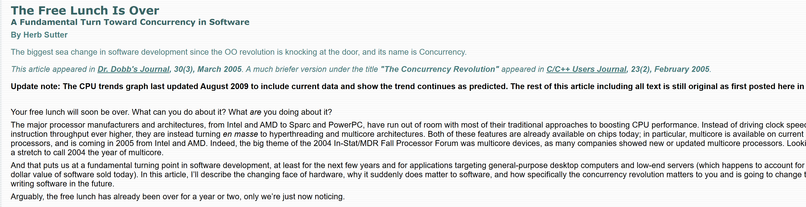

# 为什么躲不开并发

全体目光向我看齐！看我看我！我宣布个事！

没有下一句话（笑）。

您一般干活的时候，看到一个老朋友又在抽风，大概率不会停下手上的活，至少不会阻塞着看着我抽风。而是大概率耳朵听着Charliechen114514在上串下跳，但是手上还是专注于自己的事情，不过多了一个脑子的处理流而已，对吧~

大家写C++，如果您是新手，从最开始到达这里，写下的程序大多都是**单线程的**。单线程的？可能一些朋友就犯迷糊了，这是什么意思呢？

现在打开你的平凡的曾今跟随写的程序。我们的代码您摆脱一下 Agent，可以想到代码执行流从一个 `main` 开始，从头跑到底，任何时刻只有一件事在发生。你跟别人谈论的时候也是**一条线**的措辞：我先`A()`， 再`B()`，最后推出做一下`clean_up()`，我的程序完事了。

是不是很直来直去？很舒服的这样的日子。因为在这个情况下，从头到尾我们就一个人再做事情：变量读出来的值就是您刚写进去的值，函数调用的顺序就是执行的顺序，出了问题打个断点单步跟下去，总能在某一行亲眼看到现场。

那很高兴的是，从今天你踏入这个章节开始，好日子结束了。（大悲）

## 一顿白送的午餐

单线程的好日子有个没写出来的前提：硬件一直在替您提速。在长达二十年的时间里，CPU 的主频几乎每年都在涨，您一行代码不改，换个新机器，老程序自己就快了一截，性能等于白送。

> 所以我记得网上有句玩笑话，改进你的程序干什么，相信硬件自己进步！

好吧，2026年没有这顿白送的午餐了。22年前，也就是在 2004 年这顿午餐吃到了头。Intel 那年公开取消了冲击 4GHz 的计划，把研发挪去搞双核，因为主频被散热和功耗摁住了。性能从此换了一条道走，不再把一个核做快，而是往一颗芯片里塞越来越多的核。今天您兜里的手机动不动八九个核，桌面 CPU 十几个核是家常便饭，这一走就是二十多年。

对这个转折讲得最透的是 Herb Sutter。他在 2005 年 3 月的 Dr. Dobb's Journal 上发表了 [The Free Lunch Is Over](http://www.gotw.ca/publications/concurrency-ddj.htm)，提醒所有写软件的人：性能的涨幅还挂在菜单上，但要多付钱了，付的是开发功夫、代码复杂度和测试功夫。

## 难在哪，流行的几种说法

并发躲不开，那它到底难在哪？圈子里的说法换过好几轮，咱们拣流行的说说。

老一辈流传最广的说法是，多线程这东西凡人写不对，只有少数高手才能把多线程程序伺候安稳。

> 虽然说有AI了，但是笔者跟你打赌，你用菜一点的AI，或者即使你用强大一点的模型，他也写不好并发，要不然锁大了，要不然锁小了。。。听不懂没关系，这就是我们后面要聊的。

虽然说多线程本身未必那么邪门，如果你干C++，大概率也要是天天跟咱们的并发肘击的。

所以难的是哪？好吧没人会回答。答案是难对付的是满程序找地方加锁的写法。您想啊，整个程序的内存大家都能摸到，您在各个角落配一把把锁，指望它们永远不打架，程序一大就没人真正兜得住。那些年号称能跑的程序，藏着数不清的怪 bug，都是靠人力一个一个磨平的。

后来流行的思路，是把共享看住。有的路子让大家各用各的数据，要交换就传消息，谁也别碰谁的地盘。有的路子允许共享，但把用锁的限制写死，比如任何时刻手上最多一把锁。路子不一样，想法是同一个：把共享管起来，多线程就不那么玄了，是一门能教能学的手艺。咱们卷五教的，就是这类思路在 C++ 里的落地。

还有一类流行的看法提醒您别走极端：有时候共享反而最省事。最现成的例子是数据库，它就是一大块大家共享着读写的数据，靠一套严格的约束管着，安安稳稳跑了几十年。真把共享一棍子禁死，很多本来看着简单的事，反而要绕远路去做。

另一派朴素的经验派，咱们做工程的日常里更常碰到的就是他们。老牌技术问答网站上挂了十年的高赞答案，给的建议朴实得多：能用单线程就尽量单线程，非要上线程就少碰共享数据，别开比核心数更多的线程。

这些算是笔者冲浪互联网收集到的想法，大家听个响就好。公说公有理，婆说婆有理。对您却有个共同的用处：别信“并发就该这么写”的一刀切。C++ 在这件事上也没打算给唯一答案，它备了一整个工具箱，每样工具对付一类问题。卷五剩下的内容，基本就是陪您把工具箱一件一件上手。

## 难，但是能学

说了这么多，我得坦白：我自己到现在写并发代码，都是带着敬畏的。并发不像 RAII 或者移动语义那样有明确的概念边界，学会、用对地方就算掌握，它是一整套思维方式的切换。您单线程写到现在，什么都确定、什么都可控。然后突然有一天，任务处理不过来了，或者一个网络服务要同时接几百条连接，您不得不引入多线程。从那一刻起，“这个变量现在是什么值”也得重新证明了，这事您以前从来不用想。

难归难，这门手艺是可以学的。第一单元接下来的路线是：下一篇《什么时候值得引入并发》把判断立起来，什么时候该动手，什么时候该收手。再往后《线程在机器上是什么》下到系统层，然后您亲手写第一个 `std::thread` 程序，亲眼看几条执行流的输出绞在一起。敬畏归敬畏，路是一步一步走的。

## 参考资源

咱们这一篇是背景篇，没有代码实验。时代背景的叙述对照了 Herb Sutter 的 The Free Lunch Is Over 原文与 2004 年 Intel 转向双核的公开报道，流行观点的转述参考了 Stack Overflow 的经典问答，芯片规格查了官方页面。

- [The Free Lunch Is Over — Herb Sutter](http://www.gotw.ca/publications/concurrency-ddj.htm)，Dr. Dobb's Journal 2005 年 3 月号，多核转折点上的经典判断。
- [Intel kills 4GHz Pentium — The Register](https://www.theregister.com/2004/10/14/intel_kills_4gh/)，2004 年 10 月 Intel 放弃冲 4GHz、转向双核的当时报道。
- [Is multithreading always faster? — Stack Overflow](https://stackoverflow.com/q/27319446)，单线程与多线程的性能取舍，朴素经验法则的出处。
- [RP2040 — Wikipedia](https://en.wikipedia.org/wiki/RP2040)，一美元双核 Cortex-M0+ 的规格。
- [STM32H7 系列 — STMicroelectronics](https://www.st.com/en/microcontrollers-microprocessors/stm32h7-series.html)，Cortex-M7 与 Cortex-M4 双核官方页面。
