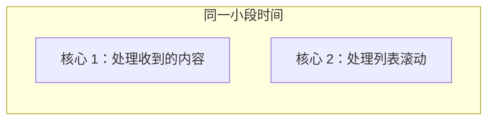

# 一个 CPU 核心怎么轮着干活

> 如果您对物理意义上的，并发，甚至是并行并不感兴趣，这篇浅谈您可直接跳过哦

上一篇咱们把下载和滚动摆成了两张图，结尾留了个问题：电脑又没有三头六臂，它到底怎么把几件事轮着往下做的？咱们今天真借一个 CPU 核心来，把时间切成小格子，看看几件事是怎么塞进去的。

## 给一个核心画一行时间

干活的是 CPU。您拆开机箱看到的那颗芯片（当然您别真拆开，装不回去别找我（手动滑稽）），里面装着一个到几十个不等的**核心**，一条条执行指令的就是这些小家伙。咱们别贪多，画一个就够。图上每一格是一小段时间，一格只装一段工作，您从左往右看。

<ConcurrencyTimeline
  title="单核 · 交替执行"
  axis-hint="时间往右 →"
  :ticks="['第 1 段', '第 2 段', '第 3 段']"
  :lanes="['一个核心']"
  :blocks="[
    { lane: 0, from: 0, to: 1, label: '发出下载请求', kind: 'download' },
    { lane: 0, from: 1, to: 2, label: '处理列表滚动', kind: 'ui' },
    { lane: 0, from: 2, to: 3, label: '处理收到的内容', kind: 'download' }
  ]"
  :kind-labels="{ download: '下载类工作', ui: '界面类工作' }"
>

</ConcurrencyTimeline>

第一格发出下载请求后，数据还在路上，格子里的活就算干完了。您往下拨了拨滚轮，正好第二格空着，就拿它处理滚动。等数据到了，第三格再处理收到的内容。回头看，从头到尾只有一个核心，下载和滚动却都往前挪了。一格里装这件事，下一格里装那件，咱们管它叫**交替执行**，上一篇说的并发，落到一个核心上就是这个样子。

您手里要是有两个核心，就可以再画一张图。这回假设内容已经到了，您正好又滚了一下列表：处理内容和处理滚动两段工作都能开工，也刚好有两个核心各领一段。

<ConcurrencyTimeline
  title="双核 · 并行"
  axis-hint="同一小段时间"
  :ticks="['']"
  :lanes="['核心 1', '核心 2']"
  :blocks="[
    { lane: 0, from: 0, to: 1, label: '处理收到的内容', kind: 'download' },
    { lane: 1, from: 0, to: 1, label: '处理列表滚动', kind: 'ui' }
  ]"
  :kind-labels="{ download: '下载类工作', ui: '界面类工作' }"
>

</ConcurrencyTimeline>

两行落在同一段时间里，各有各的活，这个画面叫**并行**。您把第二个核心拿走，退回第一张图，事情照样办得成：下载和滚动还是并发，只是从两件事同时干，变回了一件干一会儿、换另一件再干一会儿。以后再碰到并发和并行这两个词，您别背定义，画两条时间线就够了：能交替着往前走的，是并发。两段工作真挤在同一小段时间里的，才是并行。

## 到底什么东西在轮换

图上写着的处理滚动、下载讲义，是程序要做的两件事，咱们叫它们**任务**。可图画到这儿有个漏洞：任务只交代了做什么，没交代谁来做。假设咱们真写了两条执行流，一条管界面，一条管下载，各自从头到尾是一串步骤。这样的执行流，每一条都是一个**线程**。您单独拎出一条来看，还是像上一篇那样，顺着步骤一步步往下读。

轮换的活儿归操作系统管。下载线程发出请求之后要是趴下等数据，操作系统不会让核心陪着干等，它把界面线程换上去干活。等数据到了，再把下载线程换回来，从它上次停下的位置接着跑。谁这会儿上核心、谁这会儿靠边，这个安排叫**调度**。换人的瞬间系统还有件事得做：把下场的线程当时的执行状态存好，不然它再上场就忘了自己干到哪儿了。

把三个词摆在一起对一对：任务说的是要做什么，线程说的是哪条执行流去做，核心说的是哪块硬件在跑指令。一件任务可以让一条线程从头做到尾，也可以拆给几条线程。一条线程也能把两份讲义排队做完。手头有几件活、开几条线程，是咱们写程序的人定的，机器只管把您交给它的线程轮着跑。

::: warning 启动在前，完成也排在前面吗？
两条线程都开动之后，哪条干完，看的不是哪条启动得早，而是它什么时候摸到核心、中间有没有停下来等。要是界面得拿到文件才能显示内容，您就得在程序里把等文件写明白：光把启动下载的语句摆在前面，只交代了下载什么时候开始，没交代界面在哪里等结果。启动的次序您写得出来，完成的次序写不出来，它归运行时的调度管。
:::

## 参考资源

<ReferenceCard title="参考文献">

- [About Processes and Threads，Microsoft Learn](https://learn.microsoft.com/en-us/windows/win32/procthread/about-processes-and-threads)，线程的执行状态与多处理器上的执行。
- [CPU Analysis，Microsoft Learn](https://learn.microsoft.com/en-us/windows/win32/test/wpt/cpu-analysis)，CPU、物理核心与逻辑处理器的关系。
- [Multitasking，Microsoft Learn](https://learn.microsoft.com/en-us/windows/win32/procthread/multitasking)，操作系统怎样给线程分时间，以及怎样保存和恢复线程的执行状态。

</ReferenceCard>
